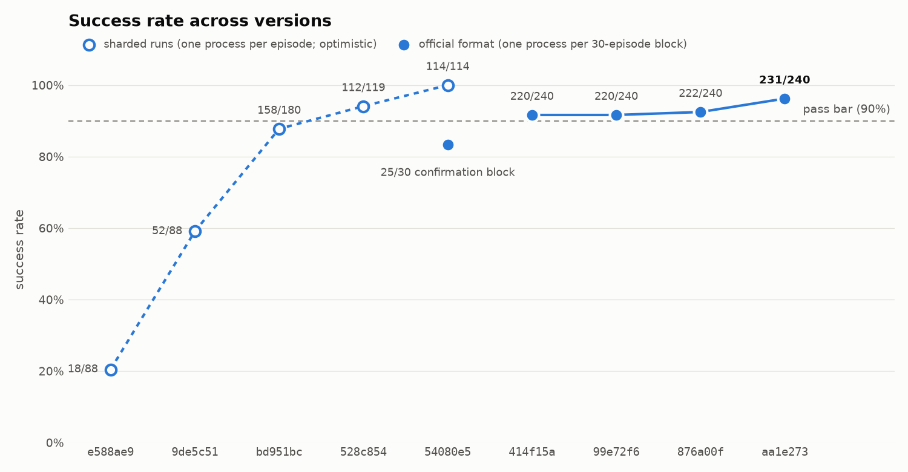
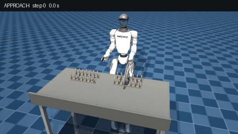
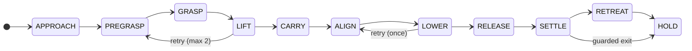

# G1 plate transfer

This repo is a closed-loop controller that makes a simulated Unitree G1 humanoid move a plate from one rack to another, using
only its three onboard cameras and its joint readings:

- a ResNet-18 estimator that finds the plate and the target slot in the camera images, and
- a state machine with forward/inverse kinematics that does the rest, with no learned actions.

It scores **27/30 on the reviewer block** (the pass bar is 27/30) and 231/240 (96%) on eight fresh development blocks.



Success rate of each frozen version. Hollow points are early sharded runs (one process per episode), which turned out to be
optimistic; solid points use the official evaluator format.

One development episode (seed 1044006, source slot 3). The first lift fails its check and the robot re-grasps:



Full write-up: [docs/modular_report.md](docs/modular_report.md) · experiment log: [EXPERIMENTS.md](EXPERIMENTS.md) ·
the original assignment: [docs/ASSIGNMENT.md](docs/ASSIGNMENT.md)

## How to run

Python 3.12, Linux. Install with [uv](https://docs.astral.sh/uv/); versions are pinned in `pyproject.toml` / `uv.lock`.
The evaluator, simulator and walking controller come from the assignment and are unchanged.

```bash
git clone https://github.com/KhushiJ2911/g1-modular-plate-transfer.git && cd g1-modular-plate-transfer
uv sync --locked --python 3.12 --no-dev
uv run --locked --no-dev advaitic-check          # checks the simulator files are unchanged
```

The policy runs in its own environment with CPU PyTorch, which also sees the evaluator's packages:

```bash
uv venv --python 3.12 .policy
uv pip install --python .policy/bin/python --index-url https://download.pytorch.org/whl/cpu torch==2.5.1 torchvision==0.20.1
eval_site=$(uv run --locked --no-dev python -c 'import sysconfig; print(sysconfig.get_path("purelib"))')
policy_site=$(.policy/bin/python -c 'import sysconfig; print(sysconfig.get_path("purelib"))')
printf '%s\n' "$eval_site" > "$policy_site/advaitic_eval_env.pth"
```

Both weight files are in the repo (`checkpoints/`). Run a 30-episode block with the official evaluator:

```bash
head=64dfe105e7f716c0ab5b7a9c487b7a8a1cac06565070b390e75992dfbee4deff
export ADV_ESTIMATOR=$PWD/checkpoints/est_v1b/last.pt ADV_HEADS=$PWD/checkpoints/astra/$head.npz
export MUJOCO_GL=egl ORT_DISABLE_TELEMETRY=1 OMP_NUM_THREADS=1 MKL_NUM_THREADS=1 OPENBLAS_NUM_THREADS=1
uv run --locked --no-dev advaitic-eval \
  --policy method.modular.vertical_clearance:make_policy --policy-python $PWD/.policy/bin/python \
  --method modular-controller --checkpoint est_v1b+heads:$head.npz \
  --episodes 30 --seed-start 7310000 --out results/final
```

A block takes about 16 minutes on a T4. Without a GPU use `MUJOCO_GL=osmesa PYOPENGL_PLATFORM=osmesa`. I ran the scored
blocks on [Modal](https://modal.com) with [ops_modular/lead_qualify.py](ops_modular/lead_qualify.py).

Useful flags and variables:

| Flag | What it does |
|---|---|
| `--seed-start` | first seed of the balanced block (5 episodes per source slot) |
| `--episodes` | 30, 36, 42, ... (must be a multiple of 6 to count) |
| `--video-episodes N` | record the first N episodes (needs `uv sync --locked --extra video`) |
| `--policy` | `method.modular.vertical_clearance:make_policy` is the final version; older ones are listed in the report |
| `ADV_ESTIMATOR`, `ADV_HEADS` | paths to the estimator checkpoint and the contact/calibration file |

The training data (about 4 GB) is on Hugging Face:
[KhushiJ2911/g1-plate-transfer-training-data](https://huggingface.co/datasets/KhushiJ2911/g1-plate-transfer-training-data).
Retrain the estimator on a CUDA GPU with the three `est_v1b/` folders under `/data`:

```bash
python -m method.harness.train_estimator --device cuda --cache-dir /cache --run-dir /runs/est_v1b \
  --data-dirs /data/teacher_v1_dart0 /data/teacher_v1_gen2 /data/dagger3_priv \
  --steps 10000 --batch-size 64 --microbatch-size 32 --val-episodes 6 --val-every 1000 --num-workers 2 --seed 42
```

The shipped checkpoint is step 8,000 of that run.

## Details

The policy sees three 84×84 RGB images (head, right wrist, left wrist) and 50 numbers of body state. It outputs 20
numbers: base velocity, pelvis height and yaw rate, 7 joint targets per arm, and two gripper commands. The walking itself
is done by BiGym2's frozen balance controller.

| Part | What it does |
|---|---|
| Estimator | ResNet-18 (ImageNet init) on the three images plus some body state; predicts plate position, nearest rack slot, plate tilt and P(held). Trained on 422 episodes with labels from simulator state |
| Contact head | linear model on the estimator features; predicts plate–rack contact |
| Kinematics | a fixed-base copy of the G1 MuJoCo model; measured joints → hand pose (FK), hand target → joint angles (damped least-squares IK) |
| State machine | 11 phases, each with an objective, an exit check and a time limit |

Simulator state is used only to make training labels and to debug on development seeds. It is never read at inference.

The phases:



| Phase | Objective | Exit check |
|---|---|---|
| APPROACH | walk to a standing spot in front of the plate; lock the target slot from a median of estimates | near the spot, slow |
| PREGRASP | hands just outside the plate edges | hands at IK targets |
| GRASP | close both grippers | finger readings say the plate is pinched |
| LIFT | raise the plate; from here the plate pose comes from FK, not the cameras | hands up, still holding |
| CARRY | walk to the target rack, holding the plate fixed relative to the pelvis | near the standing spot, slow |
| ALIGN | put the plate over the slot | plate centred over the slot |
| LOWER | lower into the slot | rack contact, or descent stalls at the right height |
| RELEASE | open both grippers, hold the arm at the pose measured at opening | grippers open |
| SETTLE | wait for the plate to rest | 75 steps, supported and upright |
| RETREAT | pull the hands back out | hands clear, plate did not move |
| HOLD | stay still; if the hands are still near the plate, back the body away slowly, then lift the hands straight up | — |

Walking is a proportional controller on distance to the standing spot (0.07–0.24 m/s). The arm commands come from IK
on the current hand target. There are no learned actions, which made every failure traceable to one check or one number.

Before this I trained policies to imitate a scripted teacher (behavioural cloning, and a fine-tuned SmolVLA). They
plateaued around 60%, and they copied the teacher's main failure: knocking the plate over after letting go. Most of the
later fixes here target exactly that moment (RELEASE → HOLD).

## Results

Official evaluator, one process per 30-episode block, frozen policy `aa1e273`:

| Run | Success | Per source slot (0–5) |
|---|---:|---|
| Reviewer block 7310000 | **27/30** | 5, 5, 5, 3, 4, 5 |
| Reviewer block, rerun 1 (same code) | 28/30 | 5, 5, 5, 3, 5, 5 |
| Reviewer block, rerun 2 (same code) | 27/30 | 5, 5, 5, 3, 4, 5 |
| 8 fresh development blocks | 231/240 (96%) | every block ≥ 27/30 |
| Confirmation block 2600000 (earlier `54080e5`) | 25/30 | 3, 5, 5, 2, 5, 5 |

The reviewer block passes with no margin. Two slot-3 seeds (7310003, 7310008) time out in every run; seed 7310000
flips between runs. Development blocks were used once each and then retired, and the reviewer block was never used
for tuning. A later attempt to fix slot 3 lost 4 episodes on paired development blocks (112 vs 116 of 120), so the
frozen version stayed. Per-episode logs are in [docs/final_7310000/](docs/final_7310000/) and every run, including the
failed ones, is in [EXPERIMENTS.md](EXPERIMENTS.md).

The longer video (all six slots, a re-grasp and a timeout) is [docs/video/plate_transfer_aa1e273.mp4](docs/video/plate_transfer_aa1e273.mp4).

## Credits

Built on:
[SWIRL BiGym2](https://github.com/swirl-uk/BiGym2) (task, G1 model, walking controller, demos) ·
the Advaitic robot-learning assignment (evaluator and interface) ·
[ResNet](https://arxiv.org/abs/1512.03385) / [Torchvision](https://pytorch.org/vision/) ·
[DAgger](https://arxiv.org/abs/1011.0686) ·
[MuJoCo](https://mujoco.org)

Most of the controller code was written with AI coding agents (Claude Code as lead, OpenAI Codex workers); the split is in
the report. Upstream code and assets keep their own licenses ([THIRD_PARTY_NOTICES.md](THIRD_PARTY_NOTICES.md)).
