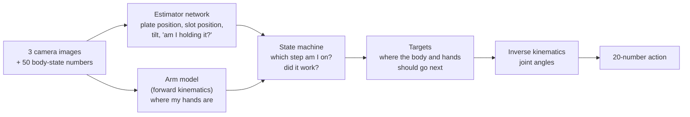
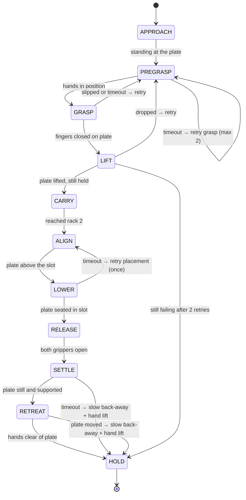
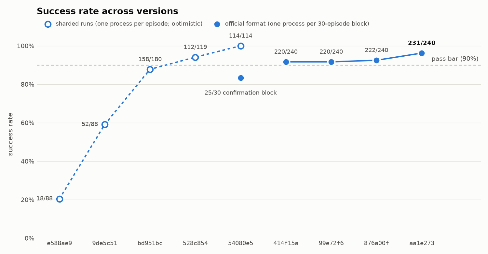

# Moving a plate with a humanoid robot

A Unitree G1 robot in simulation picks a plate off one rack, walks it over and puts it into a slot on a second rack. Our controller does this using only its three cameras and its own joint readings. On the reviewer's 30-episode test it succeeded **27/30 times (90%)**, which is exactly the pass bar.

The controller is not a single end-to-end network. Only perception is learned: a 2.9M-parameter estimator (the first three stages of an ImageNet-pretrained ResNet-18, shared across all three cameras, plus a 97K-parameter output head) reads the three 84×84 images and 19 of the 50 body-state values. It predicts the plate position, the nearest rack slot, plate tilt and whether the plate is held. A logistic-regression head (418 weights) on the same features predicts rack contact. The rest is not learned: forward and inverse kinematics on a fixed copy of the robot model, and an 11-phase state machine (about 800 lines of Python) that advances only when each phase's exit check passes.

[Video](video/plate_transfer_aa1e273.mp4) · [Full experiment log](../EXPERIMENTS.md) · [Assignment](../README.md)

## The problem

The scene is a MuJoCo simulation from [BiGym2](https://github.com/swirl-uk/BiGym2). It has a Unitree G1 humanoid with two-finger grippers, two racks and one plate.

- At the start, the plate sits in one of **six slots** ("source slots") on rack 1. Both racks are also shifted by up to ±5 cm each episode.
- The robot has to put the plate into **any** of the six slots on rack 2.
- An episode counts as a success only if the plate is upright, sitting in a slot, touching rack 2, not touching the table, and let go by both hands, and all of this still holds one simulated second later. If the robot falls or the plate hits the floor, it fails. There is a time limit.
- To pass, a policy needs **27 successes out of 30 episodes**, with exactly 5 episodes from each source slot.

Walking and balance are handled by a fixed controller that comes with BiGym2, so we only command where the body should go, not individual leg joints.

**What the policy sees:** three 84×84 colour images (one from the head camera and one from each wrist camera) and 50 numbers of body state, such as joint angles, gripper opening and body speed.

**What the policy outputs:** 20 numbers each step: how fast the body should walk forward, sideways and turn, how high the pelvis should be, a target angle for each of the 7 joints in each arm, and open/close for each gripper.

**The rules that matter most:** the policy may not read the simulator's internal state (for example the true plate position or which slot it started in). It has to work out everything from the cameras and body state. Replaying recorded motions or looking up a solution per starting position is not allowed. Using simulator state to make training labels is allowed, as long as the final policy does not use it.

## What we tried first

Before this controller we spent several days on learned policies (these runs are in earlier branches of the project, not in this repo):

- A scripted "teacher" that replays a human demonstration's arm motion and steers the body with simple feedback. It succeeded about 80% of the time (191/240). Its most common failure was knocking the plate over with the arm after letting go.
- Neural networks trained to copy the teacher from camera images. They plateaued at about 60% (for example 57/90), and a fine-tuned pretrained vision-language-action model (SmolVLA) got 44/90. More data, bigger models and other optimizers did not help.

The students were learning the teacher's mistakes along with everything else. But this task has a fixed scene: the only things that change are where the plate and racks are. So we decided to **learn only what has to be learned (where things are) and do the rest with geometry and feedback**, which we can inspect and fix one piece at a time.

## How it works



There are three parts.

### 1. Seeing: the estimator network

A ResNet-18 (a standard image network) reads all three camera images plus some body-state numbers. It predicts:

- where the plate is,
- where the nearest rack slot is,
- how tilted the plate is,
- the probability that the robot is holding the plate.

A second, tiny linear model on top of the same image features predicts whether the plate is touching the destination rack.

In the code and logs this network is called **`est_v1b`** ("estimator, version 1b"). We trained it before this controller existed and kept it frozen the whole time.

**Where its training data came from.** We ran the scripted teacher many times in simulation and saved the camera images together with the true plate and rack positions from the simulator. Those true positions are the labels. A network trained only on the teacher's runs sees only the situations the teacher gets into, so we also used **DAgger**: let the learned policy drive, record where it actually goes, and label those frames with the true positions afterwards. In total it saw 422 episodes on seeds that are never used for evaluation. The data is on Hugging Face (see [Reproduce](#reproduce)).

Two ideas made the estimates reliable enough:

- **Look while standing still.** Images are clearest when the robot is not moving, so the controller takes the median of several estimates while standing at the start and before grasping. It locks in the destination slot position at the start and does not change it later.
- **After pickup, trust the arm, not the camera.** Once the plate is in the hand it partly blocks the cameras. From then on the controller assumes the plate moves with the hand, and works out its angle from the arm joints.

### 2. Knowing where the hands are: the arm model

The controller keeps its own copy of the robot's MuJoCo model, with the robot fixed in place. Feeding it the measured joint angles tells us exactly where each hand is (**forward kinematics**, FK). Asking it "which joint angles put the hand here?" gives arm commands (**inverse kinematics**, IK). This copy never reads the live simulation. It only uses the robot's fixed geometry, which the rules allow.

### 3. Deciding what to do: the state machine

The episode is a fixed sequence of steps (phases). Each phase moves toward a goal, and it only moves on when a check passes. If a phase takes too long, the controller retries or stops safely instead of doing something random.



| Phase | What the robot does | How it knows the phase is done |
| --- | --- | --- |
| APPROACH | Walks to a standing spot in front of the plate | Close enough to the spot, and slow |
| PREGRASP | Puts both hands just outside the plate edges | Hands close to the IK targets |
| GRASP | Closes both grippers | Finger readings say the plate is pinched |
| LIFT | Raises the plate | Hand height (from FK) went up and the fingers still hold |
| CARRY | Walks to rack 2 | Close to the standing spot for the locked slot |
| ALIGN | Moves the plate above the slot | Plate (from FK) is centred over the slot |
| LOWER | Lowers the plate into the slot | Rack contact detected, or the hands stop going down at the right height |
| RELEASE | Opens both grippers and holds the arm still | Grippers measured open |
| SETTLE | Waits for the plate to settle | 75 steps open, plate supported and upright |
| RETREAT | Pulls the open hands back out the way they came in | Hands clear, plate did not move |
| HOLD | If the hands are still near the plate (settling or retreat got stuck): backs the body away slowly while watching the plate, then lifts the open hands straight up out of the rack. Otherwise stays still | — |

Release and retreat took most of our effort. The most common failure was: the robot opens its hands, the plate sits fine, and then a finger brushes the plate on the way out and knocks it out of the slot. The fixes were to hold the arm exactly where it was when the hands opened, wait for the plate to settle, and, if the hands were still close to the plate, back the body away slowly and then lift the hands **straight up** out of the rack.

The output each step is the 20-number action. The body commands come from simple feedback toward the target standing spot, and the arm commands come from IK.

## How we worked on it

Every change went through the same loop:

1. Freeze a version of the controller.
2. Run it on **fresh seeds** it had never been run on.
3. Replay every failure in simulation and sort them into buckets (missed the grasp, never let go, re-touched the plate after letting go, and so on).
4. Fix the biggest bucket and check that the fix did not break anything on the same seeds.
5. Go back to step 1 with new seeds.

**Seeds and blocks.** Each episode is set up by a seed number, and the evaluator turns a starting seed into a balanced block of 30 episodes (5 per slot). We used a separate range of seeds for development, and each block was used once and then retired, so we could not slowly tune to particular episodes. Two blocks were protected and only run on frozen versions: `2600000` as a confirmation test, and `7310000`, the reviewer's test block. We never trained or tuned on either. `7310000` was run once for the result, then twice more on the same frozen code to check it repeats.

**A mistake we caught.** For speed, our early tests ran every episode in a separate process, many at once ("sharded" runs). The official evaluator runs all 30 episodes in **one** process. The sharded numbers turned out to be about 3 points too optimistic. A version that looked like 95% scored 25/30 on the confirmation block. From then on we ran every test exactly like the official evaluator: one process per 30-episode block.

### Progress

Each line is a frozen version (commit) and the one thing it changed. Early numbers are from sharded runs, so they are useful for comparing versions but not as final scores.

| Version | What changed | Result |
| --- | --- | --- |
| `e588ae9` | First version: estimator + state machine | 18/88 (sharded) |
| `9de5c51` | Hold the plate at a calibrated angle, lock the destination slot, add rack-contact detector | 52/88 (sharded) |
| `bd951bc` | Median of estimates before pickup, check grasp and lift with finger readings | 158/180 (sharded, new seeds) |
| `528c854` | If the hands get stuck after letting go, back the body away slowly while watching the plate | 112/119 (sharded, new seeds) |
| `54080e5` | Backup way to detect "seated" from hand height | 114/114 sharded, but **25/30 on the confirmation block** |
| `414f15a` | Clear all internal memory at the start of each episode | 220/240 (91.7%), official format |
| `99e72f6` | Guards for losing grip, releasing on rack contact, plate dropping while seating | 220/240 (91.7%) |
| `876a00f` | Hold the arm exactly still when the grippers open | 222/240 (92.5%) |
| **`aa1e273`** | **After backing away, lift the open hands straight up out of the rack** | **231/240 (96.25%)** |

From `414f15a` onward each row is 8 new blocks of 30, run exactly like the official evaluator.



Hollow points are sharded runs and solid points are official-format runs. At `54080e5` the two disagree: 114/114 sharded but 25/30 on the confirmation block. That gap is why we switched to the official format.

## Results

**Final version:** commit `aa1e273`, policy `method.modular.vertical_clearance:make_policy`.

| Test | Result |
| --- | --- |
| Reviewer block 7310000, first run | **27/30, PASS** |
| Reviewer block 7310000, two reruns (same frozen code, no changes) | 28/30 PASS, 27/30 PASS |
| 8 new development blocks | 231/240 (96.25%), every block ≥ 27/30 |

Successes per source slot on the reviewer block:

| Slot | 0 | 1 | 2 | 3 | 4 | 5 |
| --- | ---: | ---: | ---: | ---: | ---: | ---: |
| First run (of 5) | 5 | 5 | 5 | 3 | 4 | 5 |
| Rerun 1 | 5 | 5 | 5 | 3 | 5 | 5 |
| Rerun 2 | 5 | 5 | 5 | 3 | 4 | 5 |

The reruns were done after the report was written, only to check that the result repeats. Nothing was changed between runs. Seeds 7310003 and 7310008 (slot 3) timed out in all three runs. Seed 7310000 (slot 4) timed out in two of the three, so small run-to-run differences in the simulation can flip that episode.

Development blocks for the final version (starting seed: successes of 30): 1039000: 29, 1045000: 30, 1055000: 27, 1065000: 29, 1075000: 30, 1085000: 29, 1095000: 30, 1046000: 27.


The full evaluator output is in [docs/final_7310000/](final_7310000/). Every run, including failed ones, is in [EXPERIMENTS.md](../EXPERIMENTS.md).

### Video

[plate_transfer_aa1e273.mp4](video/plate_transfer_aa1e273.mp4) (57 s). It shows eight development episodes covering all six source slots, including one where the first grasp slips and the robot re-grasps and succeeds, and one timeout. Details: [docs/video/README.md](video/README.md).

## What still fails

We replayed the failures of the last few versions in simulation. They fall into a few types:

1. **Re-touching the plate after letting go.** This is still the largest group. The estimator says "not holding" at these moments, so the "am I holding it?" signal cannot catch it.
2. **Never letting go.** The plate reaches the rack but the "seated" checks never pass, and the robot waits until time runs out.
3. **Plate left tilted** after release.
4. **Losing the plate during lift** (rare).

Next steps would be: check finger-to-plate distance with the arm model before the body moves, add a time-based release once the plate is clearly seated, run a sweep on slot 3 with new seeds, and measure the pass rate on more fresh blocks to know the real margin.

## Reproduce

Linux, Python 3.12, [uv](https://docs.astral.sh/uv/). The evaluator, simulator and controller come from the original assignment and are unchanged.

```bash
git clone https://github.com/KhushiJ2911/g1-modular-plate-transfer.git && cd g1-modular-plate-transfer
uv sync --locked --python 3.12 --no-dev
uv run --locked --no-dev advaitic-check        # checks the simulator files are unchanged
```

The weights are in the repo:

| File | What it is |
| --- | --- |
| `checkpoints/est_v1b/last.pt` | Estimator network (sha256 `bd8ed33c…7cd`) |
| `checkpoints/astra/64dfe105….npz` | Rack-contact detector and grasp calibration |

The policy runs in its own Python environment with CPU PyTorch:

```bash
uv venv --python 3.12 .policy
uv pip install --python .policy/bin/python --index-url https://download.pytorch.org/whl/cpu \
  torch==2.5.1 torchvision==0.20.1
eval_site=$(uv run --locked --no-dev python -c 'import sysconfig; print(sysconfig.get_path("purelib"))')
policy_site=$(.policy/bin/python -c 'import sysconfig; print(sysconfig.get_path("purelib"))')
printf '%s\n' "$eval_site" > "$policy_site/advaitic_eval_env.pth"
```

Run one 30-episode block:

```bash
est_sha=bd8ed33c87383b3b208ba251d8fa0b6f957d9f03a35cf6c8d23a81ce9cd867cd
head_sha=64dfe105e7f716c0ab5b7a9c487b7a8a1cac06565070b390e75992dfbee4deff
export ADV_ESTIMATOR="$PWD/checkpoints/est_v1b/last.pt" ADV_HEADS="$PWD/checkpoints/astra/$head_sha.npz"
export MUJOCO_GL=egl ORT_DISABLE_TELEMETRY=1 OMP_NUM_THREADS=1 MKL_NUM_THREADS=1 OPENBLAS_NUM_THREADS=1

uv run --locked --no-dev advaitic-eval \
  --policy method.modular.vertical_clearance:make_policy --policy-python "$PWD/.policy/bin/python" \
  --method modular-controller --checkpoint "est_v1b@sha256:$est_sha+heads:$head_sha.npz" \
  --episodes 30 --seed-start 7310000 --out results/final
```

Our scored runs used a T4 GPU for rendering (`MUJOCO_GL=egl`), with the network on CPU. Without a GPU, use `MUJOCO_GL=osmesa PYOPENGL_PLATFORM=osmesa`. A block takes about 16 minutes on a T4. Our runner on Modal is [ops_modular/lead_qualify.py](../ops_modular/lead_qualify.py). Add `--video-episodes 3` (after `uv sync --locked --extra video`) to record videos.

<details>
<summary>Older versions, retraining and training data</summary>

**Older versions.** Check out the commit and use its policy:

| Commit | Policy |
| --- | --- |
| `e588ae9` | `submission.policy_modular:make_policy` |
| `9de5c51` | `submission.policy_modular_heads:make_policy` (heads `contact_v1_51257d33.npz`) |
| `bd951bc` | `submission.policy_modular_calibrated:make_policy` |
| `528c854` | `method.modular.base_clearance:make_policy` |
| `54080e5`, `414f15a` | `submission.policy_modular_combined:make_policy` |
| `99e72f6` | `submission.policy_modular_round4:make_policy` |
| `876a00f` | `submission.policy_modular_round4:make_measured_policy` |

**Training data.** About 4 GB on Hugging Face: [KhushiJ2911/g1-plate-transfer-training-data](https://huggingface.co/datasets/KhushiJ2911/g1-plate-transfer-training-data).

| Folder | Used for |
| --- | --- |
| `est_v1b/teacher_v1_dart0` | Estimator: teacher runs with random action noise, seeds 2200000–2200150 |
| `est_v1b/teacher_v1_gen2` | Estimator: teacher runs, seeds 2800001–2800239 |
| `est_v1b/dagger3_priv` | Estimator: DAgger runs relabeled with true positions, seeds 2500000–2500119 |
| `contact_head/` | Rack-contact detector, seeds 3021000–3021039 and 3022000–3022023 |
| `calibration/` | Grasp calibration, 12 grasps |

**Retrain the estimator** (CUDA GPU, dataset folders under `/data`). The saved checkpoint is from step 8,000 of this 10,000-step run:

```bash
python -m method.harness.train_estimator --device cuda --cache-dir /cache \
  --run-dir /runs/est_v1b \
  --data-dirs /data/teacher_v1_dart0 /data/teacher_v1_gen2 /data/dagger3_priv \
  --steps 10000 --batch-size 64 --microbatch-size 32 --val-episodes 6 \
  --val-every 1000 --num-workers 2 --seed 42
```

**Rebuild the contact detector and grasp calibration** (`runs` = the downloaded dataset folder):

```bash
out=$(mktemp -d)
OPENBLAS_NUM_THREADS=1 uv run --locked python -m method.modular.fit_refinement \
  contact "$out/contact_v1.npz" "$runs/contact_head/training" "$runs/contact_head/training_obs"
uv run --locked python ops_modular/astra_calibrate_normal.py "$runs/calibration/grasp_hand_frame.fit.json" \
  --contact "$out/contact_v1.npz" --output "$out"
```

</details>

## Where things are

| Path | What's there |
| --- | --- |
| `method/modular/` | The controller: `phases.py` (state machine), `kinematics.py` (FK/IK), `controller.py`, `vertical_clearance.py` (final policy) |
| `method/harness/` | Estimator network and its training code |
| `submission/` | Policy entry points for earlier versions |
| `ops_modular/` | Scripts that ran evaluations and experiments on Modal |
| `tests/modular/` | Unit tests for the controller |
| `docs/` | This report, video, final evaluator output |
| `src/advaitic_eval/` | The assignment's evaluator (unchanged) |

## Credits

- [SWIRL BiGym2](https://github.com/swirl-uk/BiGym2): the task, robot model, simulator, walking controller and human demonstrations. Upstream terms apply ([notices](../THIRD_PARTY_NOTICES.md)).
- Advaitic: the evaluator, scoring rules and observation/action interface.
- Torchvision: ImageNet-pretrained ResNet-18 weights.
- AI tools: I used Claude Code, with OpenAI Codex subagents Sol and Astra.
