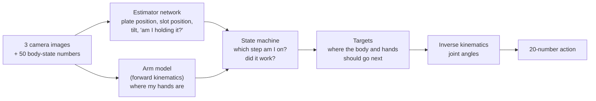
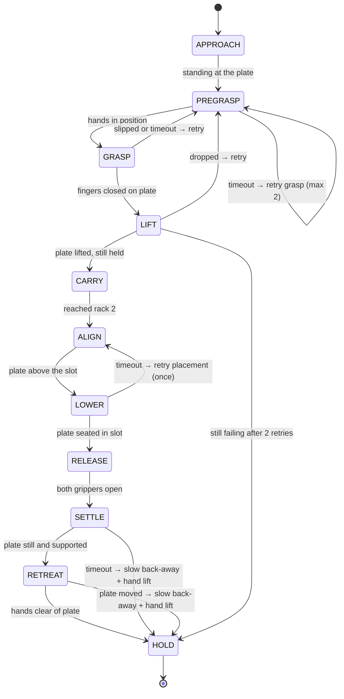
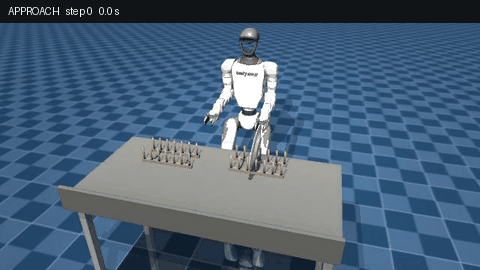

# Me, a humanoid and a plate: building a controller that passes 27/30

*A Unitree G1 in simulation picks up a plate, walks it over and puts it into a rack, using only three tiny cameras and its own joint readings.*

[Video](video/plate_transfer_aa1e273.mp4) · [Full experiment log](../EXPERIMENTS.md) · [Assignment](../README.md)

## Background and motivation

The task comes from the Advaitic robot-learning assignment. A Unitree G1 humanoid stands in front of a table with two racks on it. A plate sits in one of six slots on the first rack, and the robot has to move it into any slot on the second rack. To pass, a policy needs **27 successes out of 30 episodes**, with 5 episodes starting from each of the six slots.

The success check is strict. The plate has to be upright, sitting in a slot, touching the target rack, not touching the table, and let go by both hands, and all of this has to still be true one simulated second later. Falling, dropping the plate on the floor or running out of time all count as failures.

The robot does not get to cheat either. Every step it receives:

- three 84×84 colour images, from the head camera and the two wrist cameras, and
- 50 numbers of body state: joint angles, gripper opening, body speed and so on.

It has to answer with 20 numbers: how fast to walk forward, sideways and turn, how high to hold the pelvis, a target angle for each of the 7 joints in each arm, and open/close for each gripper. Walking and balance are handled by a frozen controller that ships with [BiGym2](https://github.com/swirl-uk/BiGym2), so the policy only says where the body should go.

It may not read the simulator's internal state (the true plate position, which slot it started in, the reward). Replaying recorded motions or looking up a solution per starting slot is also not allowed. Simulator state can be used to make training labels, as long as the final policy never sees it.

## The first attempt: copying a teacher

My first idea was the standard one: imitation learning. I wrote a scripted "teacher" that replays the arm motion from a human demonstration and steers the body with simple feedback. It succeeded on **191/240** episodes (about 80%). Then I trained networks to copy the teacher from camera images.

They got stuck around 60% (**57/90** for the best behavioural-cloning model), and a fine-tuned SmolVLA got **44/90**. More data, bigger models and a different optimizer did not move the number.

Looking at the failures, the students were copying the teacher's mistakes along with everything else. The teacher's most common failure was placing the plate fine and then knocking it over with its arm after letting go, and the students did the same.

But this task has a fixed scene. The robot, the table and the racks are always the same; the only things that change are which slot the plate starts in and a few centimetres of rack position. So I changed the plan: **learn only what has to be learned (where things are), and do everything else with geometry and feedback.** If something goes wrong, I can then point at the exact check or number that caused it.

## How it works

TL;DR for those who have not seen one: a **state machine** splits a job into steps. Each step has one goal and one check. The robot keeps working on the current step until the check passes, then moves to the next. If a step takes too long, it retries or stops safely.

The controller has three parts:



### Seeing: the estimator

A ResNet-18 reads the three camera images plus some body state and predicts four things: where the plate is, where the nearest rack slot is, how tilted the plate is, and how likely it is that the robot is holding the plate. A small linear model on the same image features predicts whether the plate is touching the target rack.

In the code this network is called **`est_v1b`**. I trained it during the imitation-learning phase and kept it frozen for this whole project.

The labels come from the simulator. I ran the teacher many times and saved each camera frame together with the true plate and rack positions. A network trained only on the teacher's runs only sees the situations the teacher gets into, so I also used **DAgger**: let the learned policy drive, record where it actually goes, and label those frames afterwards. In total that is 422 episodes, all on seeds that are never used for evaluation.

Two small ideas made the estimates good enough to act on:

- **Look while standing still.** The images are cleanest when the robot is not moving, so the controller takes the median of several estimates while standing, both at the start and before grasping. It locks the target slot at the start and never changes it.
- **Once the plate is in hand, trust the arm.** The plate blocks the wrist cameras when held. From then on the controller assumes the plate moves with the hands and gets its pose from the arm joints.

### Knowing where the hands are: the arm model

The controller keeps its own copy of the G1's MuJoCo model, fixed in place. Feeding it the measured joint angles gives the exact hand positions (**forward kinematics**, FK). Asking it "which joint angles put the hand here?" gives arm commands (**inverse kinematics**, IK). The copy never looks at the live simulation, only at the robot's fixed geometry, which the rules allow.

### Deciding what to do: the state machine



| Phase | What the robot does | How it knows the phase is done |
| --- | --- | --- |
| APPROACH | Walks to a standing spot in front of the plate | Close enough to the spot, and slow |
| PREGRASP | Puts both hands just outside the plate edges | Hands close to the IK targets |
| GRASP | Closes both grippers | Finger readings say the plate is pinched |
| LIFT | Raises the plate | Hand height (from FK) went up and the fingers still hold |
| CARRY | Walks to rack 2 | Close to the standing spot for the locked slot |
| ALIGN | Moves the plate above the slot | Plate (from FK) is centred over the slot |
| LOWER | Lowers the plate into the slot | Rack contact detected, or the hands stop going down at the right height |
| RELEASE | Opens both grippers and holds the arm still | Grippers measured open |
| SETTLE | Waits for the plate to settle | 75 steps open, plate supported and upright |
| RETREAT | Pulls the open hands back out the way they came in | Hands clear, plate did not move |
| HOLD | If the hands are still near the plate (settling or retreat got stuck): backs the body away slowly while watching the plate, then lifts the open hands straight up out of the rack. Otherwise stays still | — |

To understand it simply, take carrying. Nothing here is learned. Every step the body gets a walking speed proportional to its distance from a standing spot in front of the target slot (between 0.07 and 0.24 m/s). The arms get a hand target that keeps the plate at a fixed spot relative to the pelvis, and IK turns that into joint angles. When the body is within 2.5 cm of the spot and has slowed down, CARRY is done.

Here is one real episode (seed 1044006, plate starting in slot 3). The first lift fails its check, the robot opens its hands and grasps again, and the second try works:



*one development episode of the final policy, labelled with the current phase*

## Getting it to work

The loop was the same every time: freeze a version, run it on seeds it had never seen, replay every failure in simulation, sort the failures into buckets, fix the biggest bucket, repeat.

### Does it do anything at all?

The first full version scored **18/88**. That sounds bad, but the failures were very regular. Of 28 failures I audited, 19 had carried the plate all the way to the target rack and then just stood there holding it until time ran out. Seven had lost the plate on the way.

So the robot could pick up and carry; it could not place. The plate arrived at the wrong angle and the "seated" check never passed. Holding the plate at a calibrated angle, locking the target slot at the start, and adding the rack-contact detector took it to **52/88**. Taking the median of standing-still estimates before pickup and checking the grasp and lift with the finger readings took it to **158/180** on fresh seeds.

### The plate was fine, until I let go

Now the failures changed shape. I replayed all 22 failures of that version: **15 of them had placed the plate, opened the hands, cleared the plate, and then touched it again.** A finger brushed the plate on the way out and knocked it out of the slot. It was the same failure the teacher had, coming back in a new form.

The "am I holding it?" estimate could not help here: at every one of these re-touches it correctly said "not holding". The problem was the hand's path after release. The first fix was simple: if the hands are still near the plate after letting go, back the body away slowly while watching the plate, and stop if the plate moves. That scored **112/119** on fresh seeds.

### Did the fast numbers lie?

To move quickly I had been running each episode in its own process, many at once ("sharded" runs). The next version, which added a backup way to detect that the plate is seated, scored **114/114** that way. Then I ran it once on a protected confirmation block, the way the official evaluator does it (one process for all 30 episodes), and it scored **25/30**.

So no, the sharded numbers did not survive. My first guess was that some state was leaking from one episode to the next inside the single process. I added a cleanup that clears all episode state on reset, but the audit found no leak that changed any action, and only 7 of 20 failures passed when re-run alone. The honest answer is that the sharded runs were about 3 points optimistic, and I could not pin down one cause.

From then on every test ran exactly like the official evaluator: one process per 30-episode block, on blocks of seeds that were used once and then retired.

### Pushing past 92

In the official format the controller sat at **220/240** (91.7%), on eight fresh blocks of 30. The replays still pointed at the release, so the next fixes stayed there. Guards for losing grip and for releasing on rack contact did not move the total (**220/240**). Holding the arm exactly at the pose measured when the grippers opened, so the arm cannot push the plate, gave **222/240**. Finally, after backing away, the robot lifts its open hands straight up out of the rack before anything else moves. That version scored **231/240**, and every one of its eight blocks scored at least 27/30. The last two numbers come from different blocks, so part of that jump may be luck.

Here is the whole history:

| Version | What changed | Result |
| --- | --- | --- |
| `e588ae9` | First version: estimator + state machine | 18/88 (sharded) |
| `9de5c51` | Hold the plate at a calibrated angle, lock the destination slot, add rack-contact detector | 52/88 (sharded) |
| `bd951bc` | Median of estimates before pickup, check grasp and lift with finger readings | 158/180 (sharded, new seeds) |
| `528c854` | If the hands get stuck after letting go, back the body away slowly while watching the plate | 112/119 (sharded, new seeds) |
| `54080e5` | Backup way to detect "seated" from hand height | 114/114 sharded, but **25/30 on the confirmation block** |
| `414f15a` | Clear all internal memory at the start of each episode | 220/240 (91.7%), official format |
| `99e72f6` | Guards for losing grip, releasing on rack contact, plate dropping while seating | 220/240 (91.7%) |
| `876a00f` | Hold the arm exactly still when the grippers open | 222/240 (92.5%) |
| **`aa1e273`** | **After backing away, lift the open hands straight up out of the rack** | **231/240 (96.25%)** |


*hollow points are sharded runs, solid points use the official format; at `54080e5` they disagree, which is why I switched*

## Results

**Final version:** commit `aa1e273`, policy `method.modular.vertical_clearance:make_policy`.

| Test | Result |
| --- | --- |
| Reviewer block 7310000, first run | **27/30, PASS** |
| Reviewer block 7310000, two reruns (same frozen code, no changes) | 28/30 PASS, 27/30 PASS |
| 8 new development blocks | 231/240 (96.25%), every block ≥ 27/30 |

Successes per source slot on the reviewer block:

| Slot | 0 | 1 | 2 | 3 | 4 | 5 |
| --- | ---: | ---: | ---: | ---: | ---: | ---: |
| First run (of 5) | 5 | 5 | 5 | 3 | 4 | 5 |
| Rerun 1 | 5 | 5 | 5 | 3 | 5 | 5 |
| Rerun 2 | 5 | 5 | 5 | 3 | 4 | 5 |

The reruns were done after the report was written, only to check that the result repeats. Nothing was changed between runs. Seeds 7310003 and 7310008 (slot 3) timed out in all three runs. Seed 7310000 (slot 4) timed out in two of the three, so small run-to-run differences in the simulation can flip that episode.

Development blocks for the final version (starting seed: successes of 30): 1039000: 29, 1045000: 30, 1055000: 27, 1065000: 29, 1075000: 30, 1085000: 29, 1095000: 30, 1046000: 27.

The full evaluator output is in [docs/final_7310000/](final_7310000/). Every run, including failed ones, is in [EXPERIMENTS.md](../EXPERIMENTS.md).

The [video](video/plate_transfer_aa1e273.mp4) (57 s) shows eight development episodes covering all six source slots, including the re-grasp above and one timeout. Details: [docs/video/README.md](video/README.md).

## What still fails

The remaining failures fall into a few types:

1. **Re-touching the plate after letting go.** Still the largest group, even after all the release fixes.
2. **Never letting go.** The plate reaches the rack, but the "seated" checks never pass and the robot waits until time runs out.
3. **Plate left tilted** after release.
4. **Losing the plate during the lift** (rare).

I also tried one fix aimed at slot 3: a check at the start of the lift that compares how the plate moves in the images with how the wrist moves. On four paired development blocks it scored **112/120** against **116/120** for the frozen version, and it lost two slot-3 episodes, so I kept the frozen version.

Next I would check finger-to-plate distance with the arm model before the body moves, add a time-based release once the plate is clearly seated, and run more fresh blocks to know the real margin above 27/30.

## Conclusion

The biggest lesson was where the difficulty actually was. Seeing the plate, grasping it and carrying it were solved early. Almost all the remaining work went into the moments after the hands open, a moment the imitation-learning approach kept getting wrong and could not explain. Splitting the controller into small steps with explicit checks made those failures visible, one replay at a time.

The second lesson was about measurement. A fast test that does not match the real evaluator can look great and still be wrong, and I only found out because I kept one protected block aside.

## Reproduce

Linux, Python 3.12, [uv](https://docs.astral.sh/uv/). The evaluator, simulator and controller come from the original assignment and are unchanged.

```bash
git clone <this repo> && cd <this repo>
uv sync --locked --python 3.12 --no-dev
uv run --locked --no-dev advaitic-check        # checks the simulator files are unchanged
```

The weights are in the repo:

| File | What it is |
| --- | --- |
| `checkpoints/est_v1b/last.pt` | Estimator network (sha256 `bd8ed33c…7cd`) |
| `checkpoints/astra/64dfe105….npz` | Rack-contact detector and grasp calibration |

The policy runs in its own Python environment with CPU PyTorch:

```bash
uv venv --python 3.12 .policy
uv pip install --python .policy/bin/python --index-url https://download.pytorch.org/whl/cpu \
  torch==2.5.1 torchvision==0.20.1
eval_site=$(uv run --locked --no-dev python -c 'import sysconfig; print(sysconfig.get_path("purelib"))')
policy_site=$(.policy/bin/python -c 'import sysconfig; print(sysconfig.get_path("purelib"))')
printf '%s\n' "$eval_site" > "$policy_site/advaitic_eval_env.pth"
```

Run one 30-episode block:

```bash
est_sha=bd8ed33c87383b3b208ba251d8fa0b6f957d9f03a35cf6c8d23a81ce9cd867cd
head_sha=64dfe105e7f716c0ab5b7a9c487b7a8a1cac06565070b390e75992dfbee4deff
export ADV_ESTIMATOR="$PWD/checkpoints/est_v1b/last.pt" ADV_HEADS="$PWD/checkpoints/astra/$head_sha.npz"
export MUJOCO_GL=egl ORT_DISABLE_TELEMETRY=1 OMP_NUM_THREADS=1 MKL_NUM_THREADS=1 OPENBLAS_NUM_THREADS=1

uv run --locked --no-dev advaitic-eval \
  --policy method.modular.vertical_clearance:make_policy --policy-python "$PWD/.policy/bin/python" \
  --method modular-controller --checkpoint "est_v1b@sha256:$est_sha+heads:$head_sha.npz" \
  --episodes 30 --seed-start 7310000 --out results/final
```

Our scored runs used a T4 GPU for rendering (`MUJOCO_GL=egl`), with the network on CPU. Without a GPU, use `MUJOCO_GL=osmesa PYOPENGL_PLATFORM=osmesa`. A block takes about 16 minutes on a T4. Our runner on Modal is [ops_modular/lead_qualify.py](../ops_modular/lead_qualify.py). Add `--video-episodes 3` (after `uv sync --locked --extra video`) to record videos.

<details>
<summary>Older versions, retraining and training data</summary>

**Older versions.** Check out the commit and use its policy:

| Commit | Policy |
| --- | --- |
| `e588ae9` | `submission.policy_modular:make_policy` |
| `9de5c51` | `submission.policy_modular_heads:make_policy` (heads `contact_v1_51257d33.npz`) |
| `bd951bc` | `submission.policy_modular_calibrated:make_policy` |
| `528c854` | `method.modular.base_clearance:make_policy` |
| `54080e5`, `414f15a` | `submission.policy_modular_combined:make_policy` |
| `99e72f6` | `submission.policy_modular_round4:make_policy` |
| `876a00f` | `submission.policy_modular_round4:make_measured_policy` |

**Training data.** About 4 GB on Hugging Face: [KhushiJ2911/g1-plate-transfer-training-data](https://huggingface.co/datasets/KhushiJ2911/g1-plate-transfer-training-data).

| Folder | Used for |
| --- | --- |
| `est_v1b/teacher_v1_dart0` | Estimator: teacher runs with random action noise, seeds 2200000–2200150 |
| `est_v1b/teacher_v1_gen2` | Estimator: teacher runs, seeds 2800001–2800239 |
| `est_v1b/dagger3_priv` | Estimator: DAgger runs relabeled with true positions, seeds 2500000–2500119 |
| `contact_head/` | Rack-contact detector, seeds 3021000–3021039 and 3022000–3022023 |
| `calibration/` | Grasp calibration, 12 grasps |

**Retrain the estimator** (CUDA GPU, dataset folders under `/data`). The saved checkpoint is from step 8,000 of this 10,000-step run:

```bash
python -m method.harness.train_estimator --device cuda --cache-dir /cache \
  --run-dir /runs/est_v1b \
  --data-dirs /data/teacher_v1_dart0 /data/teacher_v1_gen2 /data/dagger3_priv \
  --steps 10000 --batch-size 64 --microbatch-size 32 --val-episodes 6 \
  --val-every 1000 --num-workers 2 --seed 42
```

**Rebuild the contact detector and grasp calibration** (`runs` = the downloaded dataset folder):

```bash
out=$(mktemp -d)
OPENBLAS_NUM_THREADS=1 uv run --locked python -m method.modular.fit_refinement \
  contact "$out/contact_v1.npz" "$runs/contact_head/training" "$runs/contact_head/training_obs"
uv run --locked python ops_modular/astra_calibrate_normal.py "$runs/calibration/grasp_hand_frame.fit.json" \
  --contact "$out/contact_v1.npz" --output "$out"
```

</details>

## Where things are

| Path | What's there |
| --- | --- |
| `method/modular/` | The controller: `phases.py` (state machine), `kinematics.py` (FK/IK), `controller.py`, `vertical_clearance.py` (final policy) |
| `method/harness/` | Estimator network and its training code |
| `submission/` | Policy entry points for earlier versions |
| `ops_modular/` | Scripts that ran evaluations and experiments on Modal |
| `tests/modular/` | Unit tests for the controller |
| `docs/` | This report, video, final evaluator output |
| `src/advaitic_eval/` | The assignment's evaluator (unchanged) |

## Credits

- [SWIRL BiGym2](https://github.com/swirl-uk/BiGym2): the task, robot model, simulator, walking controller and human demonstrations. Upstream terms apply ([notices](../THIRD_PARTY_NOTICES.md)).
- Advaitic: the evaluator, scoring rules and observation/action interface.
- Torchvision: ImageNet-pretrained ResNet-18 weights.
