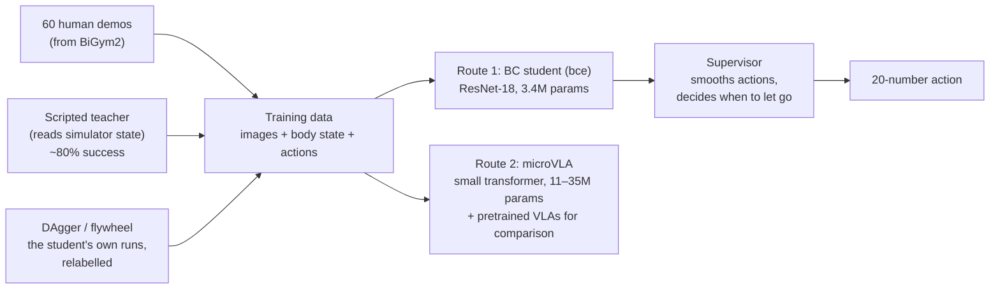
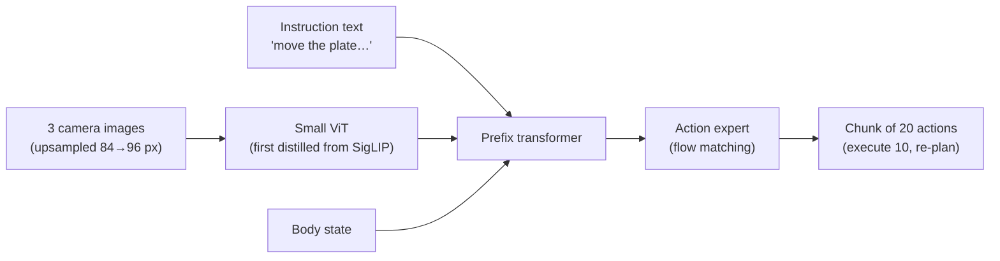

# Moving a plate with a humanoid robot: the learned-policy route

A Unitree G1 robot in simulation picks a plate off one rack, walks it over and puts it into a slot on a second rack. On this branch we tried to solve it with **learned policies**: neural networks that look at the cameras and output the robot's actions directly. We tried two families:

1. **BC students ("bce")**: a small ResNet-18 network trained to copy a scripted teacher (behaviour cloning).
2. **VLAs**: our own small vision-language-action model (**microVLA**), plus three large pretrained VLAs (SmolVLA, pi0.5, MolmoAct2) for comparison.

The best network was a BC student called **bce1**. With a supervisor wrapped around it, it reached **77/90 (86%)** on development seeds. On the reviewer's 30-episode test block it scored **15/30 (FAIL)**, and **56/90 (62%)** over three test blocks. The pass bar is 27/30 (90%).

The approach that **did** pass (27/30, then 28/30) is the modular controller on `main`, described in [modular_report.md](https://github.com/KhushiJ2911/g1-modular-plate-transfer/blob/main/docs/modular_report.md). This report covers what we tried before it, what we learned, and why we stopped.

[Full experiment log](../EXPERIMENTS.md) · [Assignment](../README.md) · [Test-block output](vla_test_7310000/) · [All checkpoints (release `vla-artifacts`)](https://github.com/KhushiJ2911/g1-modular-plate-transfer/releases/tag/vla-artifacts)

## The problem

The scene is a MuJoCo simulation from [BiGym2](https://github.com/swirl-uk/BiGym2). It has a Unitree G1 humanoid with two-finger grippers, two racks and one plate.

- At the start, the plate sits in one of **six slots** on rack 1, and both racks are shifted by up to ±5 cm.
- The robot has to put the plate into **any** slot on rack 2.
- An episode succeeds only if the plate is upright, seated in a slot, touching rack 2, off the table and released by both hands, and all of this still holds one simulated second later. Falling, dropping the plate or running out of time is a failure.
- To pass, a policy needs **27 of 30 episodes**, with 5 from each source slot.

**What the policy sees:** three 84×84 colour images (head camera and one on each wrist) and 50 body-state numbers.
**What it outputs:** 20 numbers each step: walking speed and turn, pelvis height, 7 arm-joint targets per arm, and open/close for each gripper.
**The key rule:** at test time the policy may only use those observations. Simulator state may be used to make training labels, but not by the final policy.

## The big picture

The plan was standard imitation learning: build something that can do the task while using privileged state (the **teacher**), record many runs of it, and train a network to copy it from camera images alone (the **student**).



## Step 1: the teacher and the training data

**Human demos alone were not enough.** BiGym2 ships 60 human demonstrations. A network trained only on them scored **0/30**. 60 episodes don't cover six slots with shifting racks.

**So we wrote a scripted teacher.** It is allowed to read the simulator state (true plate and rack positions). It replays the arm motion of the closest human demo, adjusted to where the plate actually is, and steers the body with simple feedback. It succeeds about **80%** of the time (27/30 on its first block, 79–84% over hundreds of data runs). Slot 1 is consistently its hardest. Code: `method/teacher/`.

**Training data**, all on training seeds (2000000–2999999), never on test seeds:

| Data | Episodes | What it is |
| --- | ---: | --- |
| `human60` | 60 | BiGym2 human demos |
| `teacher_v1`, `teacher_v1_dart0` | 202 | Teacher runs, some with injected action noise so the student sees recoveries |
| `dagger`, `dagger2`, `dagger3` | ~110+ | **DAgger**: the student drives, and the teacher labels what it should have done |

## Step 2, route 1: the BC student (bce)

### The network

- One **ResNet-18** (ImageNet-pretrained, cut after layer 3) shared by all three cameras.
- **Spatial softmax** turns each image into keypoints ("where are the interesting things in this image").
- Those keypoints plus 19 body-state numbers go into a small head that predicts the **next 20 actions at once** (action chunking, as in ACT).
- 3.35M parameters. It trains on a laptop.

### The fix that made it work: treat the gripper as yes/no

The first students (v1a, v1b) scored **0/30**. They reached the plate, grasped it and carried it, but **never let go**. "Open the gripper" happens in only a few frames of each episode, and a regression loss averages it away.

We changed the gripper output from a number to a **classification** (binary cross-entropy, with extra weight on "open"). The same network went from **0/30 to 14/30**, and later **57/90 (63%)**. That checkpoint, `student_v1b_bce1.pt`, is **bce1**. Nothing we trained afterwards beat it.

### Trying to train past bce1

| Version | What we changed | Dev result |
| --- | --- | --- |
| **bce1** | Gripper as classification | **57/90** |
| bce2a/b, bce3a/b | DAgger on bce1's own runs, loose or strict "when to open" labels | 24–44/90 |
| bce4a/b | More teacher data | 47/90, 54/90 |
| bce5 | DAgger relabelling every action, not only the gripper | 0–6/30 |
| bce6c/d | "Flywheel": retrain on bce1's own successful runs | 52/90, 60/90 (with ensembling) |
| bce7r/m | Residual MLP head vs plain head | 46/90, 36/90 (with ensembling) |

**Why this didn't work.** The student can only be as good as what it copies. The teacher is right about 80% of the time, so more teacher data teaches the same 20% of mistakes again. DAgger labels come from that same teacher. The flywheel (training only on the student's own successes) didn't add enough new behaviour to matter.

## Step 2, route 2: microVLA and the pretrained VLAs

### What microVLA is

[microVLA](https://github.com/KhushiJ2911/microVLA) is our own small vision-language-action model, trained from scratch:



- **Vision:** a small ViT. It is first trained for 3,000 steps to imitate the features of a frozen SigLIP model (**distillation**). Without this step the model doesn't learn usable vision. We first launched a run without it by mistake, and the user caught it.
- **Action expert:** generates the 20-step action chunk by **flow matching** (start from noise and refine it into actions over a few steps), the same idea as pi0.
- **Size:** 11.2M parameters (v1). The large version has 35.3M.
- Adapted to this task by Codex brief #10: three cameras, a loss that skips action dimensions without trusted labels, and the policy wrapper `submission/policy_vla.py`.

### What we tried

| Version | What we changed | Dev result |
| --- | --- | --- |
| microVLA v1 | SigLIP distill 3k + 10k flow steps, same data as BC | 32/90 (36%) |
| v1, execute 5 instead of 10 | Re-plan more often | 12/30 vs 11/30, no effect |
| v2a | 128 px images (finer patches) | 14/90 (16%), clearly worse |
| **v2b** | **+ DAgger data** | **44/90 (49%)**, best microVLA |
| large | 3× parameters (35.3M), 2× training steps | 30/90 (33%), significantly worse than v2b (p ≈ 0.03) |
| Muon optimizer | Muon vs AdamW learning-rate sweep on the large model | Muon fit training data faster but did worse on held-out episodes, so we kept AdamW |

**What we learned from microVLA:**

- **Lower training loss did not mean more successes.** The large model had 16% lower validation loss than v2b and still did worse on the task. Validation loss was a poor guide throughout.
- **It failed in different places than BC.** We replayed every failure. microVLA mostly **lost the plate at pickup** (the hand stopped 10–14 cm from the plate instead of ~8 cm) or **let go a few centimetres off the slot**, so the plate slid onto the table. bce1 mostly got the plate onto the rack but **didn't settle it**. The problem was centimetre-level hand positioning, not gripper timing: re-planning more often didn't help.
- **More data helped and more parameters hurt.** DAgger data took it from 36% to 49%. Tripling the size dropped it to 33%. With only a few hundred episodes, a bigger model over-fits.

### Pretrained VLAs, for comparison

To check whether a big pretrained model would do better, we fine-tuned three public VLAs on the same 262 labelled episodes, using a fixed budget of about $25:

| Model | How we trained it | Dev result |
| --- | --- | --- |
| SmolVLA | Action expert only, 5k steps (~30 min A100) | 44/90 (49%), equal to microVLA v2b |
| pi0.5 | Action expert only, 1k steps (budget-limited) | 4/90 |
| MolmoAct2 | LoRA + action expert, 1.5k steps (budget-limited) | 4/90 |
| pi0.5 / MolmoAct2, no fine-tuning | Zero-shot | 0/90, 0/90 |

pi0.5 and MolmoAct2 saw well under one pass over the data, so these numbers show what a few dollars of fine-tuning buys, not what these models can do. pi0.5 also takes about 3 minutes to load, longer than the evaluator's default 2-minute timeout.

### Benchmark summary

| Model | Parameters | Dev success |
| --- | ---: | ---: |
| **bce1 (BC)** | 3.35M | **57/90 (63%)** |
| SmolVLA (fine-tuned) | ~100M trained | 44/90 (49%) |
| microVLA v2b | 11.2M | 44/90 (49%) |
| microVLA large | 35.3M | 30/90 (33%) |
| pi0.5 (fine-tuned) | expert only | 4/90 |
| MolmoAct2 (fine-tuned) | 737M learnable | 4/90 |

**The smallest model won.** For this amount of data, a small convolutional network with a good gripper loss beat every transformer, ours and pretrained. So we stopped training new models and worked on how bce1 is *used*.

## Step 3: wrapping bce1 in a supervisor

bce1 usually carried the plate to the right place but let go at the wrong moment or wobbled near the rack. Instead of retraining, we wrapped it in a supervisor (`submission/harness.py`). It never reads simulator state, only the same cameras and body readings.

- **Temporal ensembling.** Each step, average every chunk that predicted this step and execute only 2 steps before asking again. This smooths out jitter.
- **Estimator-gated release.** A separate small network (`est_v1b`, later `est_v2`) estimates from the cameras how far the plate is from the slot and how tilted it is. The supervisor keeps the grippers closed until the plate is close enough and upright enough.
- **Seat cue.** Releasing also requires the wrist to lag behind its command by at least 0.024 rad for 10 steps in a row. That lag means the plate is pressing on the rack.
- **Release-height guard** (final version). Don't release until the plate is estimated at most 2 cm above the slot.

| Version | What changed | Dev result |
| --- | --- | --- |
| bce1 alone | Reference | 57/90 (63%) |
| + temporal ensembling | Average overlapping chunks, execute 2 steps | 192/270 (71%) |
| + release supervisor + seat cue | Let go only when close, upright and resting | 71/90 (79%) |
| + est_v2 or release-height guard | Better near-rack estimator, or don't release from too high | 77/90 (86%) |
| Tried and dropped | Re-grip, tilt correction, multi-checkpoint ensembles, 1-step re-planning | 17/60 to 64/90 |

## How we worked on it

We worked as a small team: Claude Code as the lead, plus OpenAI Codex workers (Astra and Sol) taking self-contained briefs such as training code, failure diagnosis, estimator audits and harness features. Every brief and report is in [artifacts/briefs/](../artifacts/briefs/). Training and evaluation ran on Modal GPUs (T4, L4, A10, A100). The scripts are in [artifacts/ops/](../artifacts/ops/).

The loop was always the same:

1. Train or change one thing.
2. Run it 3 × 30 episodes on development seeds, using the official evaluator.
3. Replay every failure in simulation with the true state switched on (analysis only) and sort it into a bucket: never grasped, slipped, stopped short, didn't let go, didn't settle, dropped. Tools: `artifacts/analysis/replay_eval.py`, `classify_failures.py`.
4. Go after the biggest bucket.

**Seeds.**

| Block | Use |
| --- | --- |
| `1000000` | Development. Everything was tuned here. |
| `2000000`–`2999999` | Training data only. |
| `2600100` | Confirmation. Fresh seeds, run only on frozen versions. |
| `7310000` | Reviewer test block. Run once, at the very end, on the frozen final version. |

## Results

**Final version:** checkpoint `bce1`, supervisor at harness commit `dc4c10a`, policy `submission.policy_harness:make_policy`, with `est_v2`, temporal ensembling, seat cue (10 steps) and the release-height guard.
**Baseline:** the same bce1 with temporal ensembling only, no supervisor.

| Test | Final | Baseline | Seed by seed |
| --- | ---: | ---: | --- |
| Dev `1000000` (tuned on) | 77/90 (86%) | 192/270 (71%) | — |
| Confirmation `2600100`, 3 blocks | 67/90 (74%) | 51/90 (57%) | +20 / −5, p = 0.004 |
| **Reviewer block `7310000`, the official 30** | **15/30, FAIL** | 18/30 | — |
| Test, 3 blocks from `7310000` | 56/90 (62%) | 55/90 (61%) | +14 / −10, p = 0.54 |

Successes per source slot on the reviewer block (of 5):

| Slot | 0 | 1 | 2 | 3 | 4 | 5 |
| --- | ---: | ---: | ---: | ---: | ---: | ---: |
| Final | 4 | 2 | 2 | 3 | 2 | 2 |
| Baseline | 4 | 3 | 4 | 1 | 4 | 2 |

All 180 test episodes ran without policy errors. Every failure was a timeout: the robot never fell and the plate never hit the floor.

**What these numbers say:**

1. **The dev numbers were too optimistic.** We picked the best of about ten variants on the same dev seeds, so the winner always looked better than it was. The last +6 on dev mostly disappeared on fresh seeds.
2. **The supervisor helps on fresh seeds overall, but not on the test block alone.** Pooled over confirmation and test it scored 123/180 (68%) vs 106/180 (59%), p ≈ 0.01. On the test block alone the two were level.
3. **The blocks overlap slightly.** The evaluator builds a block by scanning forward from the start seed until every slot has 5 episodes, and our blocks started only 30 seeds apart. Only 82 of each 90 seeds were distinct.

Full evaluator output: [vla_test_7310000/](vla_test_7310000/) and [vla_confirm_2600100/](vla_confirm_2600100/). Every dev run is in [artifacts/results/modal/evals/](../artifacts/results/modal/evals/) and the [experiment log](../EXPERIMENTS.md).

## What still fails, and why we stopped

Replaying the last 19 dev failures of the best version:

1. **Let go too high.** All 11 failures that opened the gripper did so 3.5–4.2 cm above the slot, because the estimator under-read the height by about 1.3 cm. The plate drops and tips. est_v2 and the height guard both targeted this, but neither helped on fresh seeds.
2. **Tipped on the rack.** The plate arrives under 20° of tilt but tips further after an early release. Our tilt-correction attempt made things worse (64/90).
3. **Stalls.** The student stops moving near the rack and waits until time runs out.

**The deeper problem is the ceiling.** The student copies a teacher that succeeds only about 80% of the time, and copying loses another 15–20 points on top. Even a perfect copy would land in the low 80s, below the 90% bar. Every attempt to get past the teacher through training failed: DAgger, the flywheel, bigger BC heads, microVLA, larger microVLA and pretrained VLAs.

That is why the passing approach on `main` uses a network **only for seeing** (where the plate and slot are) and does control with an arm model and a state machine that checks each step. We also considered running a teacher-like controller on estimated state, but dropped it: even with perfect state, the teacher itself misses 90%.

## Reproduce

Linux, Python 3.12, [uv](https://docs.astral.sh/uv/). The evaluator, simulator and walking controller are the assignment's, unchanged.

```bash
git clone <this repo> && cd <this repo> && git checkout vla
uv sync --locked --python 3.12 --no-dev
uv run --locked --no-dev advaitic-check        # checks the simulator files are unchanged
```

Weights in the repo:

| File | What it is |
| --- | --- |
| `checkpoints/student_v1b_bce1.pt` | bce1 student (sha256 `7535cac0…`) |
| `checkpoints/est_v2/last.pt` | Near-rack estimator used by the final version (sha256 `cf7ae472…`) |
| `checkpoints/est_v1b/last.pt` | Original estimator, used by the baseline (sha256 `bd8ed33c…`) |

Every other checkpoint (all bce variants, microVLA v1/v2a/v2b/large) is on the GitHub release [`vla-artifacts`](https://github.com/KhushiJ2911/g1-modular-plate-transfer/releases/tag/vla-artifacts), with `SHA256SUMS`.

The policy runs in its own Python environment with PyTorch (we used torch 2.5.1 and torchvision 0.20.1):

```bash
uv venv --python 3.12 .policy
uv pip install --python .policy/bin/python --index-url https://download.pytorch.org/whl/cpu \
  torch==2.5.1 torchvision==0.20.1
eval_site=$(uv run --locked --no-dev python -c 'import sysconfig; print(sysconfig.get_path("purelib"))')
policy_site=$(.policy/bin/python -c 'import sysconfig; print(sysconfig.get_path("purelib"))')
printf '%s\n' "$eval_site" > "$policy_site/advaitic_eval_env.pth"
```

Run the final version on one 30-episode block:

```bash
export ADV_CKPT="$PWD/checkpoints/student_v1b_bce1.pt" ADV_ESTIMATOR="$PWD/checkpoints/est_v2/last.pt"
export ADV_H_TEMPORAL_ENSEMBLE=1 ADV_H_ENSEMBLE_DECAY=0.0 ADV_H_SEAT_CUE=1 ADV_H_SEAT_STEPS=10 ADV_H_RELEASE_HEIGHT_GUARD=1
export MUJOCO_GL=egl ORT_DISABLE_TELEMETRY=1 OMP_NUM_THREADS=1

uv run --locked --no-dev advaitic-eval \
  --policy submission.policy_harness:make_policy --policy-python "$PWD/.policy/bin/python" \
  --method bce1-harness --checkpoint bce1 \
  --episodes 30 --seed-start 7310000 --out results/final
```

For the baseline, use `ADV_ESTIMATOR="$PWD/checkpoints/est_v1b/last.pt" ADV_H_TEMPORAL_ENSEMBLE=1 ADV_H_ENSEMBLE_DECAY=0.0 ADV_H_SUPERVISE=0`. For a microVLA checkpoint from the release, use `--policy submission.policy_vla:make_policy` with `ADV_CKPT` pointing at it. Our scored runs used a Modal T4 for rendering with the networks on CPU (`artifacts/ops/modal_sim.py`), about 25 minutes per block.

<details>
<summary>Retraining</summary>

**BC student (bce1).** Fine-tuned from `student_v1b.pt` (paths in the config point at the local data folders):

```bash
python -m method.bc.train --config method/bc/student_v1b_bce.yaml
```

**microVLA.** `method/vla/train.py` with `--distill --distill-steps 3000 --siglip-path google/siglip-base-patch16-224`, then 10k flow steps (configs `method/vla/microvla_v1.yaml`, `microvla_large.yaml`). Details and the Muon option are in `method/vla/README.md` and briefs `artifacts/briefs/10_*`, `11_*`.

**Teacher data.** `method/teacher/` with `--mode v1 --dart-noise 0`, run on Modal by `artifacts/ops/modal_teacher.py`.

**est_v2.** A 2,000-step A10 fine-tune of `est_v1b` that oversamples hovering and tilted frames near the rack: `method/harness/finetune_estimator.py`. Audit: `method/harness/estimator_audit.py` (brief and report: `artifacts/briefs/22_*`).

**Data.** The estimator data is on Hugging Face: [KhushiJ2911/g1-plate-transfer-training-data](https://huggingface.co/datasets/KhushiJ2911/g1-plate-transfer-training-data). The student datasets (several GB) are on the project's Modal volumes and not in this repo.

</details>

## Where things are

| Path | What's there |
| --- | --- |
| `method/teacher/` | Scripted teacher (training data only) |
| `method/bc/` | BC student network, dataset and training code |
| `method/dagger/` | DAgger collection and relabelling |
| `method/vla/` | microVLA adapter, trainer, Muon optimizer, configs |
| `method/harness/` | Estimators (training, fine-tuning, audit) |
| `submission/` | Policy entry points: `policy.py` (plain student), `policy_harness.py` (final), `policy_vla.py` (microVLA) |
| `checkpoints/` | bce1, est_v1b, est_v2 |
| `docs/` | This report and the held-out evaluator output |
| `artifacts/ops/` | Modal training and eval scripts |
| `artifacts/analysis/` | Failure replay and classification |
| `artifacts/briefs/` | Every Codex brief and its report |
| `artifacts/results/` | Dev eval output and failure-replay summaries |
| `artifacts/viz/` | GIFs of human demos, teacher, DAgger and bce1 episodes |
| `EXPERIMENTS.md` | Every run, including failed and invalid ones |

## Credits

- [SWIRL BiGym2](https://github.com/swirl-uk/BiGym2): the task, robot model, simulator, walking controller and the 60 human demonstrations. Upstream terms apply ([notices](../THIRD_PARTY_NOTICES.md)).
- Advaitic: the evaluator, scoring rules and observation/action interface.
- [microVLA](https://github.com/KhushiJ2911/microVLA) (MIT); SigLIP for its vision distillation.
- Torchvision ImageNet ResNet-18; robomimic-style spatial softmax; ACT-style action chunking and temporal ensembling; DAgger; Muon (Keller Jordan) and Moonlight.
- Pretrained VLAs, fine-tuned only for comparison: SmolVLA and pi0.5 (via LeRobot), MolmoAct2.
- AI tools: Claude Code (lead) and OpenAI Codex (Astra, Sol) wrote much of the code under review. Briefs and reports are in `artifacts/briefs/`.
