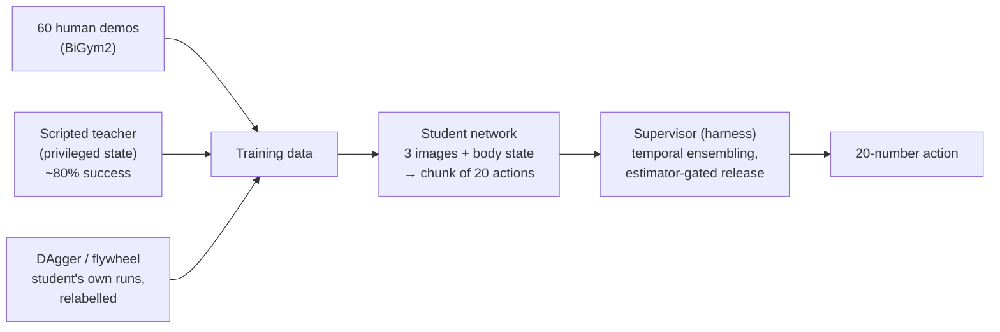

# Moving a plate with a humanoid robot: the learned-policy route

This branch (`vla`) is the **learned-policy** half of the project: imitation learning, DAgger, small and large vision-language-action (VLA) models, and finally a learned student wrapped in a supervisor. It did **not** reach the pass bar. On the reviewer's 30-episode block it succeeded **15/30 times (50%)**, and on 90 held-out test episodes 56/90 (62%), against the required 27/30 (90%).

The approach that did pass, a modular controller (estimator network + arm model + state machine, 27/30 and 28/30 on the same block), is on `main` and described in [modular_report.md](https://github.com/KhushiJ2911/g1-modular-plate-transfer/blob/main/docs/modular_report.md). This report explains what we tried before that, what worked, what didn't, and why we stopped.

[Full experiment log](../EXPERIMENTS.md) · [Assignment](../README.md) · [Held-out results](vla_test_7310000/)

## The problem

Same task as on `main`: a Unitree G1 in BiGym2/MuJoCo picks a plate from one of six slots on rack 1 and puts it into any slot on rack 2. Success means the plate is upright, seated, touching rack 2, off the table and released by both hands, still true one simulated second later. Passing needs **27/30**, with 5 episodes from each source slot.

**What the policy sees:** three 84×84 colour images (head and both wrists) and 50 body-state numbers.
**What it outputs:** 20 numbers per step: body velocity and height, 7 arm-joint targets per arm, and open/close for each gripper.
**The key rule:** at test time the policy may use only those observations. Simulator state may only be used to make training labels.

## The idea

Teach a neural network to copy a demonstrator, end to end from pixels to actions:



### 1. The teacher

A scripted controller that **may** read simulator state. It replays the arm motion of the nearest human demonstration and steers the body with simple feedback. It succeeds about **80%** of the time (27/30 on its first 30 seeds, 79–84% over hundreds of data-generation episodes) and always struggles on source slot 1. It exists only to generate training data. Code: `method/teacher/`.

### 2. The student (`bce1`)

The network that actually gets evaluated:

- a ResNet-18 (ImageNet start, cut after layer 3) shared across the three cameras, with spatial-softmax keypoints,
- plus 19 body-state numbers,
- predicting a **chunk of 20 future actions** (ACT-style), with an L1 loss on the arm/body targets.

The single change that made it work at all was the gripper. Early students (v1a, v1b) scored **0/30**: they reached the plate, but the "open gripper" command is rare in the data and a regression loss averaged it away, so they never let go. Treating open/close as a **classification** (binary cross-entropy with extra weight on "open") took the same network from 0/30 to **14/30**. That checkpoint, `student_v1b_bce1.pt` (sha256 `7535cac0…`), is called **bce1** and stayed our best network to the end. Code: `method/bc/`, config `method/bc/student_v1b_bce.yaml`.

### 3. The supervisor (harness)

bce1 knew how to carry the plate but often placed it badly or let go at the wrong moment. Instead of retraining, we wrapped it (`submission/harness.py`, policy `submission.policy_harness:make_policy`):

- **Temporal ensembling.** Every step, average all the chunks that predicted this step, with equal weights, and only execute 2 steps before asking again. Smooths jitter.
- **Estimator-gated release.** A small separate network (`est_v1b`, later `est_v2`) estimates from the cameras how far the plate is from the slot and how tilted it is. The supervisor only lets the grippers open when the plate is close enough and upright enough.
- **Seat cue.** Releasing also needs the wrist to have stopped moving (stayed within 0.024 rad of its target) for 10 steps, a sign the plate is resting in the slot.
- **Release-height guard** (final version). Don't release until the plate is estimated at most 2 cm above the slot.

The supervisor never reads simulator state. It only uses the same camera images and body readings.

## How we worked on it

The same team as on `main`: Claude Code as the lead, plus OpenAI Codex workers (Astra and Sol) taking self-contained briefs: training code, diagnosis, estimator audits and harness features. Every brief and report is in [artifacts/briefs/](../artifacts/briefs/). Training and evaluation ran on Modal (T4/L4/A10/A100). Scripts are in [artifacts/ops/](../artifacts/ops/).

**Seeds.**

| Block | Use |
| --- | --- |
| `1000000` | Development. Everything was tuned here, 3 × 30 episodes per configuration. |
| `2000000`–`2999999` | Training only: teacher, DAgger and flywheel data. |
| `2600000` | Confirmation. Fresh seeds, run only on frozen versions. |
| `7310000` | Reviewer test block. Run once, at the end, on the frozen final version. |

**Every failure got replayed.** The evaluator saves each episode's actions. We replayed them in the same physics with the true state switched on (analysis only) and sorted failures into buckets: never grasped, slipped, stopped short of the rack, on the rack but not released, released but not settled, tipped. Tools: `artifacts/analysis/replay_eval.py`, `classify_failures.py`, `replay_rack.py`.

## Progress

All numbers are successes on dev block `1000000` unless marked. One run is 30 episodes; most rows pool three runs (90).

**Getting a student to work at all**

| Version | What changed | Result |
| --- | --- | --- |
| BC on human demos | 60 human demos only | 0/30 |
| Student v1a, v1b | + teacher demos (227 episodes) | 0/30, 0/30 (never opens the gripper) |
| v1a + DAgger | + the student's own runs, relabelled by the teacher | 0/30 |
| **bce1** | **gripper as classification (BCE)** | **14/30, then 57/90 (63%)** |

**Trying to beat bce1 by training** (none did)

| Version | What changed | Result |
| --- | --- | --- |
| bce2a/b, bce3a/b | DAgger data from bce1's own runs, loose or strict labels | 24–44/90 |
| bce4a/b | More teacher data | 47/90, 54/90 |
| bce5 | Full-action DAgger | 0–6/30 |
| bce6c/d | "Flywheel": retrain on bce1's own successful runs | 52/90, 60/90 (with ensembling) |
| bce7r/m | Residual MLP head vs plain head | 46/90, 36/90 (with ensembling) |

**Bigger models** (none beat bce1)

| Model | What it is | Result |
| --- | --- | --- |
| microVLA v1 / v2b / large | Our own small VLA: SigLIP-distilled vision + flow-matching action head, trained from scratch | 32/90, 44/90, 30/90 |
| SmolVLA | Pretrained VLA, fine-tuned action expert | 44/90 |
| pi0.5 | Pretrained VLA, fine-tuned action expert | 4/90 |
| MolmoAct2 | Pretrained VLA, LoRA + action expert | 4/90 |
| pi0.5 / MolmoAct2 base | Zero-shot, no fine-tuning | 0/90, 0/90 |

Tripling the size of our own VLA made it significantly *worse* (44 → 30/90, p ≈ 0.03). With 60 human demos and a few hundred teacher runs, the big pretrained models didn't have enough task data to adapt.

**Wrapping bce1 in the supervisor**

| Version | What changed | Dev result |
| --- | --- | --- |
| bce1 | Reference | 57/90 (63%) |
| + temporal ensembling | Average overlapping chunks, execute 2 steps | 65/90 (72%) |
| + release supervisor + seat cue (10 steps) | Release only when estimated close, upright and resting | 71/90 (79%) |
| + est_v2 or release-height guard | Better near-rack estimator, or don't release from too high | 77/90 (86%) |
| Tried and dropped | Regrip, tilt correction, multi-checkpoint ensembles, 1-step re-planning | 17/60 to 64/90 |

## Results

**Final version:** branch `vla`, harness commit `dc4c10a`, checkpoint `bce1`, policy `submission.policy_harness:make_policy` with:

```
ADV_ESTIMATOR=checkpoints/est_v2/last.pt ADV_H_TEMPORAL_ENSEMBLE=1 ADV_H_ENSEMBLE_DECAY=0.0
ADV_H_SEAT_CUE=1 ADV_H_SEAT_STEPS=10 ADV_H_RELEASE_HEIGHT_GUARD=1
```

The **baseline** is the same bce1 with temporal ensembling but no supervisor (`ADV_H_SUPERVISE=0`, `ADV_ESTIMATOR=est_v1b`).

| Test | Final | Baseline | Seed by seed |
| --- | ---: | ---: | --- |
| Dev `1000000` (tuned on) | 77/90 (86%) | 192/270 (71%) | — |
| Confirmation `2600100`–`2600189` | 67/90 (74%) | 51/90 (57%) | +20 / −5, p = 0.004 |
| **Reviewer block `7310000`, the official 30** | **15/30, FAIL** | 18/30 | — |
| Test, 3 blocks from `7310000` | 56/90 (62%) | 55/90 (61%) | +14 / −10, p = 0.54 |

Successes per source slot on the reviewer block (of 5):

| Slot | 0 | 1 | 2 | 3 | 4 | 5 |
| --- | ---: | ---: | ---: | ---: | ---: | ---: |
| Final | 4 | 2 | 2 | 3 | 2 | 2 |
| Baseline | 4 | 3 | 4 | 1 | 4 | 2 |

All 180 test episodes ran without policy errors. Every failure was a timeout: the robot never fell and the plate never hit the floor.

**What these numbers say:**

1. **The dev numbers were too optimistic.** We picked the best of about ten variants on the same dev seeds, so the winner always looked a few points better than it really was. The est_v2 / height-guard gain (+6 on dev) mostly vanished on fresh seeds (+1).
2. **The supervisor helps on held-out seeds, but not on the test block alone.** Pooled over confirmation and test: final 123/180 (68%) vs baseline 106/180 (59%), seed by seed +34 / −15 (p ≈ 0.01). On the test block alone, it's flat (62% vs 61%).
3. **The blocks overlap a little.** The evaluator builds each block by scanning forward from the start seed until every slot has 5 episodes. Our three 30-episode blocks started only 30 seeds apart, so some seeds repeat: only 82 of each 90 were distinct.

Full evaluator output: [vla_test_7310000/](vla_test_7310000/) and [vla_confirm_2600100/](vla_confirm_2600100/). Every dev run is in [artifacts/results/modal/evals/](../artifacts/results/modal/evals/) and the [experiment log](../EXPERIMENTS.md).

## What still fails, and why we stopped

Replaying the last 19 dev failures of the best version:

1. **Released too high.** All 11 failures that opened the gripper did so 3.5–4.2 cm above the slot, because the estimator understated the distance by about 1.3 cm. The plate drops and tips. est_v2 and the height guard both targeted this; neither moved the held-out numbers.
2. **Tilted on the rack.** The plate reaches the rack under 20° but tips past it after an early release. Our tilt-correction controller made things worse (64/90).
3. **Stalls.** The student stops moving near the rack and waits until time runs out.

**The deeper problem is the ceiling.** The student copies a teacher that itself only succeeds about 80% of the time, and copying loses another 15–20 points. Even a perfect copy would land in the low 80s, below the 90% bar. Every attempt to get past the teacher through training (DAgger, a flywheel, bigger models) failed. That's why the passing approach on `main` keeps the network for perception only and does control with geometry and a state machine. We considered running a teacher-like controller on estimated state instead of imitating it, but stopped: it can at best match the teacher with perfect state, which also misses 90%.

## Reproduce

Linux, Python 3.12, [uv](https://docs.astral.sh/uv/). The evaluator, simulator and controller are the assignment's, unchanged.

```bash
git clone <this repo> && cd <this repo> && git checkout vla
uv sync --locked --python 3.12 --no-dev
uv run --locked --no-dev advaitic-check        # checks the simulator files are unchanged
```

Weights in the repo:

| File | What it is |
| --- | --- |
| `checkpoints/student_v1b_bce1.pt` | bce1 student (sha256 `7535cac0…`) |
| `checkpoints/est_v2/last.pt` | Near-rack estimator used by the final version (sha256 `cf7ae472…`) |
| `checkpoints/est_v1b/last.pt` | Original estimator, used by the baseline (sha256 `bd8ed33c…`) |

Every other checkpoint (all bce variants, microVLA, the large model) is attached to the GitHub release **`vla-artifacts`**.

The policy runs in its own Python environment with PyTorch (we used torch 2.5.1, torchvision 0.20.1):

```bash
uv venv --python 3.12 .policy
uv pip install --python .policy/bin/python --index-url https://download.pytorch.org/whl/cpu \
  torch==2.5.1 torchvision==0.20.1
eval_site=$(uv run --locked --no-dev python -c 'import sysconfig; print(sysconfig.get_path("purelib"))')
policy_site=$(.policy/bin/python -c 'import sysconfig; print(sysconfig.get_path("purelib"))')
printf '%s\n' "$eval_site" > "$policy_site/advaitic_eval_env.pth"
```

Run the final version on one 30-episode block:

```bash
export ADV_CKPT="$PWD/checkpoints/student_v1b_bce1.pt" ADV_ESTIMATOR="$PWD/checkpoints/est_v2/last.pt"
export ADV_H_TEMPORAL_ENSEMBLE=1 ADV_H_ENSEMBLE_DECAY=0.0 ADV_H_SEAT_CUE=1 ADV_H_SEAT_STEPS=10 ADV_H_RELEASE_HEIGHT_GUARD=1
export MUJOCO_GL=egl ORT_DISABLE_TELEMETRY=1 OMP_NUM_THREADS=1

uv run --locked --no-dev advaitic-eval \
  --policy submission.policy_harness:make_policy --policy-python "$PWD/.policy/bin/python" \
  --method bce1-harness --checkpoint bce1 \
  --episodes 30 --seed-start 7310000 --out results/final
```

For the baseline, use `ADV_ESTIMATOR="$PWD/checkpoints/est_v1b/last.pt" ADV_H_TEMPORAL_ENSEMBLE=1 ADV_H_ENSEMBLE_DECAY=0.0 ADV_H_SUPERVISE=0`. Our scored runs used a Modal T4 for rendering with the networks on CPU (`artifacts/ops/modal_sim.py`, `artifacts/ops/spawn.py`), about 25 minutes per block.

<details>
<summary>Retraining</summary>

**Student (bce1).** Fine-tuned from `student_v1b.pt` on CPU (paths in the config point at the local data folders):

```bash
python -m method.bc.train --config method/bc/student_v1b_bce.yaml
```

Data: 60 BiGym2 human demos, `teacher_v1` and `teacher_v1_dart0` teacher runs, `dagger` and `dagger2` relabelled student runs, all on training seeds. The estimator data (`teacher_v1_dart0`, `teacher_v1_gen2`, `dagger3_priv`) is on Hugging Face: [KhushiJ2911/g1-plate-transfer-training-data](https://huggingface.co/datasets/KhushiJ2911/g1-plate-transfer-training-data). The remaining student datasets (several GB) are on the project's Modal volumes and are not in this repo.

**Teacher data.** `method/teacher/` with `--mode v1 --dart-noise 0`, run on Modal by `artifacts/ops/modal_teacher.py`.

**est_v2.** A 2,000-step A10 fine-tune of `est_v1b` that oversamples hovering and tilted frames near the rack: `method/harness/finetune_estimator.py`, launched by `method/harness/modal_estimator.py`. Audit: `method/harness/estimator_audit.py` (brief and report: `artifacts/briefs/22_*`).

**microVLA.** `method/vla/`, briefs `artifacts/briefs/10_*`, `11_*` (Muon optimizer sweep).

</details>

## Where things are

| Path | What's there |
| --- | --- |
| `method/bc/` | Student network, dataset and training code |
| `method/teacher/` | Scripted teacher (training data only) |
| `method/dagger/` | DAgger collection and relabelling |
| `method/harness/` | Estimators (training, fine-tuning, audit) |
| `method/vla/` | Our microVLA |
| `submission/` | Policy entry points: `policy.py` (plain student), `policy_harness.py` (final), `policy_multi.py`, `policy_vla.py` |
| `checkpoints/` | bce1, est_v1b, est_v2 |
| `docs/` | This report, held-out evaluator output |
| `artifacts/ops/` | Modal training/eval scripts and their logs |
| `artifacts/analysis/` | Failure replay and classification |
| `artifacts/briefs/` | Every Codex brief and its report |
| `artifacts/results/` | Dev eval output (episodes, actions, reports), failure-replay summaries |
| `artifacts/viz/` | GIFs of human demos, teacher, DAgger and bce1 episodes |
| `EXPERIMENTS.md` | Every run, including failed and invalid ones |

## Credits

- [SWIRL BiGym2](https://github.com/swirl-uk/BiGym2): task, robot model, simulator, walking controller and the 60 human demonstrations. Upstream terms apply ([notices](../THIRD_PARTY_NOTICES.md)).
- Advaitic: the evaluator, scoring rules and observation/action interface.
- Torchvision ImageNet ResNet-18; robomimic-style spatial softmax; ACT-style action chunking and temporal ensembling; DAgger.
- Pretrained VLAs, fine-tuned only for comparison: SmolVLA, pi0.5 (via LeRobot), MolmoAct2; SigLIP for the microVLA distillation.
- AI tools: Claude Code (lead) and OpenAI Codex (Astra, Sol) wrote much of the code under review. Briefs and reports are in `artifacts/briefs/`.
