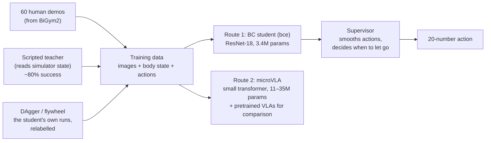
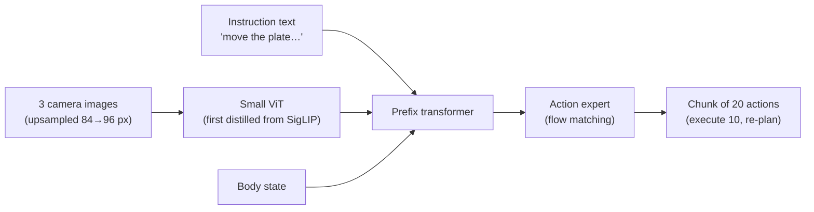

# Moving a plate with a humanoid robot: the learned-policy route

A Unitree G1 robot in simulation picks a plate off one rack, walks it over and puts it into a slot on a second rack. This branch documents our attempt to solve the task with **learned policies**, meaning neural networks that map camera images directly to robot actions. We tried two families of models.

1. **Behaviour-cloning students ("bce")**: a small ResNet-18 network trained to imitate a scripted teacher.
2. **Vision-language-action models (VLAs)**: our own small VLA, **microVLA**, and three large pretrained VLAs (SmolVLA, pi0.5 and MolmoAct2) for comparison.

The best network was a behaviour-cloning student called **bce1**. Wrapped in a supervisor, it reached **77/90 (86%)** on development seeds. On the reviewer's 30-episode test block it scored **15/30**, which fails the pass bar of 27/30 (90%), and it scored **56/90 (62%)** over three test blocks.

The approach that **did** pass, scoring 27/30 and then 28/30, is the modular controller on `main`, described in [modular_report.md](https://github.com/KhushiJ2911/g1-modular-plate-transfer/blob/main/docs/modular_report.md). This report describes what we tried before that controller, what we learned and why we stopped.

[Full experiment log](../EXPERIMENTS.md) · [Assignment](../README.md) · [Test-block output](vla_test_7310000/) · [All checkpoints (release `vla-artifacts`)](https://github.com/KhushiJ2911/g1-modular-plate-transfer/releases/tag/vla-artifacts)

## The problem

The scene is a MuJoCo simulation from [BiGym2](https://github.com/swirl-uk/BiGym2). It has a Unitree G1 humanoid with two-finger grippers, two racks and one plate.

- At the start, the plate sits in one of **six slots** on rack 1, and both racks are shifted by up to ±5 cm.
- The robot has to put the plate into **any** slot on rack 2.
- An episode succeeds only if the plate is upright, seated in a slot, touching rack 2, off the table and released by both hands, and all of this still holds one simulated second later. Falling, dropping the plate or running out of time is a failure.
- To pass, a policy needs **27 of 30 episodes**, with 5 from each source slot.

The policy sees three 84×84 colour images, one from the head camera and one from each wrist, together with 50 body-state numbers. Each step it outputs 20 numbers: walking speed and turn rate, pelvis height, seven arm-joint targets per arm, and an open/close command for each gripper.

The most important rule is that the evaluated policy may use only these observations. Simulator state may be used to create training labels, but never by the policy at test time.

## The big picture

We followed the standard imitation-learning recipe. First we built a **teacher** that solves the task using privileged simulator state. Then we recorded many of its runs and trained a **student** network to reproduce its actions from camera images and body state alone.



## Step 1: the teacher and the training data

BiGym2 provides 60 human demonstrations. A network trained on these alone scored **0/30**, because 60 episodes do not cover six source slots with randomly shifted racks.

We therefore wrote a scripted teacher (`method/teacher/`). The teacher reads the true plate and rack positions from the simulator. It replays the arm motion of the closest human demonstration, shifted to the actual plate position, and steers the body with simple feedback. It succeeds about **80%** of the time: 27/30 on its first block and 79–84% across hundreds of data-generation runs. Source slot 1 is consistently its hardest case.

All training data was generated on training seeds (2000000–2999999) and never on evaluation seeds:

| Data | Episodes | What it is |
| --- | ---: | --- |
| `human60` | 60 | BiGym2 human demos |
| `teacher_v1`, `teacher_v1_dart0` | 202 | Teacher runs, some with injected action noise so the student sees recoveries |
| `dagger`, `dagger2`, `dagger3` | ~110+ | **DAgger**: the student drives, and the teacher labels what it should have done |

## Step 2, route 1: the BC student (bce)

### The network

The student is a small convolutional network with 3.35M parameters, small enough to train on a laptop.

- A single **ResNet-18**, pretrained on ImageNet and truncated after layer 3, processes all three camera images.
- A **spatial-softmax** layer converts each feature map into a set of 2D keypoints.
- A small head takes the keypoints and 19 body-state numbers and predicts the **next 20 actions at once** (action chunking, as in ACT).

### The fix that made it work: treat the gripper as yes/no

The first students (v1a and v1b) scored **0/30**. They reached, grasped and carried the plate, but they **never released it**. The "open" command appears in only a few frames of each episode, so a regression loss averages it away.

We changed the gripper output from a regressed value to a **binary classification**, trained with binary cross-entropy and an extra weight on "open". This single change took the same network from **0/30 to 14/30**, and later to **57/90 (63%)**. That checkpoint, `student_v1b_bce1.pt`, is called **bce1**. No model we trained afterwards outperformed it.

### Trying to train past bce1

| Version | What we changed | Dev result |
| --- | --- | --- |
| **bce1** | Gripper as classification | **57/90** |
| bce2a/b, bce3a/b | DAgger on bce1's own runs, loose or strict "when to open" labels | 24–44/90 |
| bce4a/b | More teacher data | 47/90, 54/90 |
| bce5 | DAgger relabelling every action, not only the gripper | 0–6/30 |
| bce6c/d | "Flywheel": retrain on bce1's own successful runs | 52/90, 60/90 (with ensembling) |
| bce7r/m | Residual MLP head vs plain head | 46/90, 36/90 (with ensembling) |

None of these helped because a student can only be as good as the behaviour it imitates. The teacher is correct about 80% of the time, so additional teacher data repeats the same mistakes. DAgger labels come from the same teacher, and the flywheel, which retrains only on the student's own successes, added too little new behaviour to matter.

## Step 2, route 2: microVLA and the pretrained VLAs

### What microVLA is

[microVLA](https://github.com/KhushiJ2911/microVLA) is our own small vision-language-action model, trained from scratch. Its structure is shown below.



- **Vision encoder.** A small ViT is first trained for 3,000 steps to match the features of a frozen SigLIP model (distillation). Without this step the encoder does not learn usable visual features.
- **Action expert.** The 20-step action chunk is generated by **flow matching**: the model starts from random noise and refines it into actions over a few steps, as in pi0.
- **Size.** Version 1 has 11.2M parameters and the large version has 35.3M.
- **Task adaptation.** We added support for three cameras, a loss that ignores action dimensions without trusted labels, and the policy wrapper `submission/policy_vla.py`.

### What we tried

| Version | What we changed | Dev result |
| --- | --- | --- |
| microVLA v1 | SigLIP distill 3k + 10k flow steps, same data as BC | 32/90 (36%) |
| v1, execute 5 instead of 10 | Re-plan more often | 12/30 vs 11/30, no effect |
| v2a | 128 px images (finer patches) | 14/90 (16%), clearly worse |
| **v2b** | **+ DAgger data** | **44/90 (49%)**, best microVLA |
| large | 3× parameters (35.3M), 2× training steps | 30/90 (33%), significantly worse than v2b (p ≈ 0.03) |
| Muon optimizer | Learning-rate sweep of Muon against AdamW on the large model | Lower training loss but higher validation loss than AdamW, so AdamW was kept |

Three lessons came out of the microVLA experiments.

- **Lower loss did not mean more successes.** The large model reached 16% lower validation loss than v2b but succeeded less often. Validation loss was a poor predictor of task success throughout.
- **microVLA failed in different places from the BC student.** Failure replays showed that microVLA usually **lost the plate at pickup**, with the hand stopping 10–14 cm from the plate instead of about 8 cm, or **released it a few centimetres off the slot**, so the plate slid onto the table. bce1, by contrast, usually placed the plate on the rack but **failed to seat it**. The microVLA errors came from centimetre-level hand positioning rather than gripper timing, which is why re-planning more often did not help.
- **More data helped and more parameters hurt.** Adding DAgger data raised success from 36% to 49%, while tripling the model size lowered it to 33%. With only a few hundred episodes, the larger model over-fits.

### Pretrained VLAs, for comparison

To test whether a large pretrained model would do better, we fine-tuned three public VLAs on the same 262 labelled episodes with a fixed compute budget of about $25.

| Model | How we trained it | Dev result |
| --- | --- | --- |
| SmolVLA | Action expert only, 5k steps (~30 min A100) | 44/90 (49%), equal to microVLA v2b |
| pi0.5 | Action expert only, 1k steps (budget-limited) | 4/90 |
| MolmoAct2 | LoRA + action expert, 1.5k steps (budget-limited) | 4/90 |
| pi0.5 / MolmoAct2, no fine-tuning | Zero-shot | 0/90, 0/90 |

Within this budget, pi0.5 and MolmoAct2 saw well under one pass over the data. Their numbers therefore show what a small fine-tuning budget achieves, not what these models are capable of. pi0.5 also takes about three minutes to load, which exceeds the evaluator's default two-minute timeout.

### Benchmark summary

| Model | Parameters | Dev success |
| --- | ---: | ---: |
| **bce1 (BC)** | 3.35M | **57/90 (63%)** |
| SmolVLA (fine-tuned) | ~100M trained | 44/90 (49%) |
| microVLA v2b | 11.2M | 44/90 (49%) |
| microVLA large | 35.3M | 30/90 (33%) |
| pi0.5 (fine-tuned) | expert only | 4/90 |
| MolmoAct2 (fine-tuned) | 737M learnable | 4/90 |

The smallest model performed best. With this amount of data, a small convolutional network with a classification loss for the gripper beat every transformer, both ours and the pretrained ones. We therefore stopped training new models and focused on how bce1 is executed.

## Step 3: wrapping bce1 in a supervisor

bce1 usually carried the plate to the correct place but released it at the wrong moment or wobbled near the rack. Rather than retrain it, we wrapped it in a supervisor (`submission/harness.py`). The supervisor uses only the same camera images and body readings as the policy and never reads simulator state.

- **Temporal ensembling.** At each step, the supervisor averages every predicted chunk that covers that step, executes two steps, and then queries the network again. This removes most of the jitter.
- **Estimator-gated release.** A separate small network (`est_v1b`, later `est_v2`) estimates from the cameras how far the plate is from the slot and how much it is tilted. The grippers stay closed until the plate is close enough and upright enough.
- **Seat cue.** Release also requires the wrist to lag its commanded angle by at least 0.024 rad for 10 consecutive steps. This lag indicates that the plate is pressing on the rack.
- **Release-height guard.** In the final version, the grippers do not open until the plate is estimated to be at most 2 cm above the slot.

| Version | What changed | Dev result |
| --- | --- | --- |
| bce1 alone | Reference | 57/90 (63%) |
| + temporal ensembling | Average overlapping chunks, execute 2 steps | 192/270 (71%) |
| + release supervisor + seat cue | Let go only when close, upright and resting | 71/90 (79%) |
| + est_v2 or release-height guard | Better near-rack estimator, or don't release from too high | 77/90 (86%) |
| Tried and dropped | Re-grip, tilt correction, multi-checkpoint ensembles, 1-step re-planning | 17/60 to 64/90 |

## Methodology

Every change was evaluated in the same way:

1. Change one thing: the data, the model, the training recipe or the supervisor.
2. Evaluate the result on 3 × 30 development episodes with the official evaluator.
3. Replay every failed episode in simulation with the true state recorded (for analysis only), and assign it to one category: never grasped, slipped, stopped short of the rack, never released, released but not seated, or dropped. The replay tools are `artifacts/analysis/replay_eval.py` and `artifacts/analysis/classify_failures.py`.
4. Address the largest failure category next.

Training and evaluation ran on Modal GPUs (T4, L4, A10 and A100), using the scripts in [artifacts/ops/](../artifacts/ops/). Results were compared with paired McNemar tests on shared seeds, or two-proportion tests where seeds differed.

Seeds were split into separate blocks so that no result was tuned on the data used to report it:

| Block | Use |
| --- | --- |
| `1000000` | Development. All tuning was done here. |
| `2000000`–`2999999` | Training data only. |
| `2600100` | Confirmation. Fresh seeds, run only on frozen versions. |
| `7310000` | Reviewer test block. Run once, at the end, on the frozen final version. |

## Results

The final version is checkpoint `bce1` with the supervisor at harness commit `dc4c10a` (policy `submission.policy_harness:make_policy`), using `est_v2`, temporal ensembling, a 10-step seat cue and the release-height guard. The baseline is the same bce1 with temporal ensembling only and no supervisor.

| Test | Final | Baseline | Seed by seed |
| --- | ---: | ---: | --- |
| Dev `1000000` (tuned on) | 77/90 (86%) | 192/270 (71%) | — |
| Confirmation `2600100`, 3 blocks | 67/90 (74%) | 51/90 (57%) | +20 / −5, p = 0.004 |
| **Reviewer block `7310000`, the official 30** | **15/30, FAIL** | 18/30 | — |
| Test, 3 blocks from `7310000` | 56/90 (62%) | 55/90 (61%) | +14 / −10, p = 0.54 |

Successes per source slot on the reviewer block (of 5):

| Slot | 0 | 1 | 2 | 3 | 4 | 5 |
| --- | ---: | ---: | ---: | ---: | ---: | ---: |
| Final | 4 | 2 | 2 | 3 | 2 | 2 |
| Baseline | 4 | 3 | 4 | 1 | 4 | 2 |

All 180 test episodes ran without policy errors. Every failure was a timeout; the robot never fell and the plate never hit the floor.

We draw three conclusions from these numbers.

1. **The development results were optimistic.** We selected the best of about ten variants on the same development seeds, so the selected version looked better than it really was. Most of the final +6 gain on development seeds disappeared on fresh seeds.
2. **The supervisor helps on fresh seeds overall, but not on the test block alone.** Pooled over the confirmation and test blocks, the final version scored 123/180 (68%) against 106/180 (59%) for the baseline (p ≈ 0.01). On the test block alone, the two were level.
3. **The evaluation blocks overlap slightly.** The evaluator builds each block by scanning forward from the start seed until every slot has five episodes. Because our three blocks started only 30 seeds apart, only 82 of each 90 seeds were distinct.

Full evaluator output: [vla_test_7310000/](vla_test_7310000/) and [vla_confirm_2600100/](vla_confirm_2600100/). Every dev run is in [artifacts/results/modal/evals/](../artifacts/results/modal/evals/) and the [experiment log](../EXPERIMENTS.md).

## What still fails, and why we stopped

We replayed the last 19 development failures of the best version. They fall into three groups.

1. **Release too high.** All 11 failures in which the gripper opened did so 3.5–4.2 cm above the slot, because the estimator underestimated the height by about 1.3 cm. The plate then drops and tips over. Both est_v2 and the release-height guard targeted this error, but neither improved results on fresh seeds.
2. **Tipping on the rack.** The plate reaches the rack with less than 20° of tilt but tips further after an early release. Our tilt-correction controller made results worse (64/90).
3. **Stalling.** The student stops moving near the rack and waits until the episode times out.

The underlying limit is the teacher. The student imitates a teacher that succeeds only about 80% of the time, and imitation loses a further 15–20 points. Even a perfect copy would therefore score in the low 80s, below the 90% bar. Every attempt to exceed the teacher through training failed, including DAgger, the flywheel, larger BC heads, both microVLA sizes and the pretrained VLAs.

For this reason the passing approach on `main` uses a network **only for perception**, to locate the plate and the slot, and performs control with an arm model and a state machine that verifies each step. We also considered running a teacher-style controller on estimated state, but dropped the idea because even with perfect state the teacher falls short of 90%.

## Reproduce

The steps below assume Linux, Python 3.12 and [uv](https://docs.astral.sh/uv/). The evaluator, simulator and walking controller are the assignment's, unchanged.

```bash
git clone <this repo> && cd <this repo> && git checkout vla
uv sync --locked --python 3.12 --no-dev
uv run --locked --no-dev advaitic-check        # checks the simulator files are unchanged
```

The following weights are included in the repository:

| File | What it is |
| --- | --- |
| `checkpoints/student_v1b_bce1.pt` | bce1 student (sha256 `7535cac0…`) |
| `checkpoints/est_v2/last.pt` | Near-rack estimator used by the final version (sha256 `cf7ae472…`) |
| `checkpoints/est_v1b/last.pt` | Original estimator, used by the baseline (sha256 `bd8ed33c…`) |

All other checkpoints, including every bce variant and microVLA v1, v2a, v2b and large, are on the GitHub release [`vla-artifacts`](https://github.com/KhushiJ2911/g1-modular-plate-transfer/releases/tag/vla-artifacts), with `SHA256SUMS`.

The policy runs in its own Python environment with PyTorch (we used torch 2.5.1 and torchvision 0.20.1):

```bash
uv venv --python 3.12 .policy
uv pip install --python .policy/bin/python --index-url https://download.pytorch.org/whl/cpu \
  torch==2.5.1 torchvision==0.20.1
eval_site=$(uv run --locked --no-dev python -c 'import sysconfig; print(sysconfig.get_path("purelib"))')
policy_site=$(.policy/bin/python -c 'import sysconfig; print(sysconfig.get_path("purelib"))')
printf '%s\n' "$eval_site" > "$policy_site/advaitic_eval_env.pth"
```

Run the final version on one 30-episode block:

```bash
export ADV_CKPT="$PWD/checkpoints/student_v1b_bce1.pt" ADV_ESTIMATOR="$PWD/checkpoints/est_v2/last.pt"
export ADV_H_TEMPORAL_ENSEMBLE=1 ADV_H_ENSEMBLE_DECAY=0.0 ADV_H_SEAT_CUE=1 ADV_H_SEAT_STEPS=10 ADV_H_RELEASE_HEIGHT_GUARD=1
export MUJOCO_GL=egl ORT_DISABLE_TELEMETRY=1 OMP_NUM_THREADS=1

uv run --locked --no-dev advaitic-eval \
  --policy submission.policy_harness:make_policy --policy-python "$PWD/.policy/bin/python" \
  --method bce1-harness --checkpoint bce1 \
  --episodes 30 --seed-start 7310000 --out results/final
```

To run the baseline instead, set `ADV_ESTIMATOR="$PWD/checkpoints/est_v1b/last.pt" ADV_H_TEMPORAL_ENSEMBLE=1 ADV_H_ENSEMBLE_DECAY=0.0 ADV_H_SUPERVISE=0`. For a microVLA checkpoint from the release, use `--policy submission.policy_vla:make_policy` with `ADV_CKPT` pointing at it. Our scored runs rendered on a Modal T4 GPU with the networks on CPU (`artifacts/ops/modal_sim.py`) and took about 25 minutes per block.

<details>
<summary>Retraining</summary>

**BC student (bce1).** bce1 is fine-tuned from `student_v1b.pt`. Set the data paths in the config to your local data folders, then run:

```bash
python -m method.bc.train --config method/bc/student_v1b_bce.yaml
```

**microVLA.** Run `method/vla/train.py` with `--distill --distill-steps 3000 --siglip-path google/siglip-base-patch16-224`, followed by 10k flow-matching steps. The configs are `method/vla/microvla_v1.yaml` and `method/vla/microvla_large.yaml`, and `method/vla/README.md` documents the Muon option.

**Teacher data.** Run `method/teacher/` with `--mode v1 --dart-noise 0`. We ran it on Modal with `artifacts/ops/modal_teacher.py`.

**est_v2.** est_v2 is a 2,000-step fine-tune of `est_v1b` on an A10 GPU that oversamples frames of the plate hovering or tilted near the rack. The script is `method/harness/finetune_estimator.py`. The audit script is `method/harness/estimator_audit.py`.

**Data.** The estimator data is on Hugging Face: [KhushiJ2911/g1-plate-transfer-training-data](https://huggingface.co/datasets/KhushiJ2911/g1-plate-transfer-training-data). The student datasets, several GB in total, are on the project's Modal volumes and are not included in this repository.

</details>

## Where things are

| Path | What's there |
| --- | --- |
| `method/teacher/` | Scripted teacher (training data only) |
| `method/bc/` | BC student network, dataset and training code |
| `method/dagger/` | DAgger collection and relabelling |
| `method/vla/` | microVLA adapter, trainer, Muon optimizer, configs |
| `method/harness/` | Estimators (training, fine-tuning, audit) |
| `submission/` | Policy entry points: `policy.py` (plain student), `policy_harness.py` (final), `policy_vla.py` (microVLA) |
| `checkpoints/` | bce1, est_v1b, est_v2 |
| `docs/` | This report and the held-out evaluator output |
| `artifacts/ops/` | Modal training and eval scripts |
| `artifacts/analysis/` | Failure replay and classification |
| `artifacts/briefs/` | Specification and report for each work item |
| `artifacts/results/` | Dev eval output and failure-replay summaries |
| `artifacts/viz/` | GIFs of human demos, teacher, DAgger and bce1 episodes |
| `EXPERIMENTS.md` | Every run, including failed and invalid ones |

## Credits

- [SWIRL BiGym2](https://github.com/swirl-uk/BiGym2): the task, robot model, simulator, walking controller and the 60 human demonstrations. Upstream terms apply ([notices](../THIRD_PARTY_NOTICES.md)).
- Advaitic: the evaluator, scoring rules and observation/action interface.
- [microVLA](https://github.com/KhushiJ2911/microVLA) (MIT); SigLIP for its vision distillation.
- Torchvision ImageNet ResNet-18; robomimic-style spatial softmax; ACT-style action chunking and temporal ensembling; DAgger; Muon (Keller Jordan) and Moonlight.
- Pretrained VLAs, fine-tuned only for comparison: SmolVLA and pi0.5 (via LeRobot), MolmoAct2.
- AI coding tools, as permitted by the assignment: Claude Code (Claude Opus 5.5), with GPT-6.2 models (Astra and Sol) as subagents.
